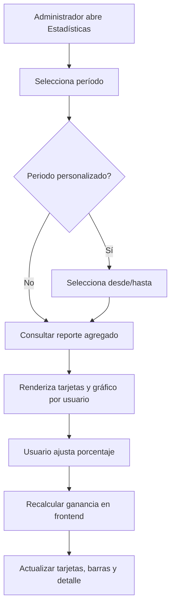

# RFC — Estadísticas de ventas por usuario

## Estado del documento

- **Tipo**: RFC técnico-funcional
- **Estado**: propuesta ajustada
- **Fecha**: 2026-04-17
- **Basado en**:
  - `src/screens/Home.js`
  - `src/navigation/NavigationStack.js`
  - `src/screens/Users.js`
  - `src/screens/NewSale.js`
  - `src/screens/EditSale.js`
  - `src/services/saleListService.js`
  - `package.json`
- **Ámbito**: frontend obligatorio, backend obligatorio

> Este RFC define la primera iteración de una nueva ventana de estadísticas. El foco NO es hacer una pantalla linda sin criterio, sino construir una vista clara para entender el rendimiento de ventas por vendedor. Esta primera fase se centra en **ventas por usuario**, con filtros por período y **ganancia calculada en el momento** según un porcentaje ingresado por el administrador.

---

## 1. Resumen ejecutivo

La app hoy permite operar ventas, usuarios, productos y clientes, pero **no tiene una vista analítica dedicada**. Apenas expone métricas básicas por usuario en `Users.js`, sin contexto temporal, sin filtros avanzados y sin representación gráfica.

### Decisiones principales de este RFC

1. Crear una nueva pantalla dedicada: **Estadísticas de ventas**.
2. La primera gráfica será un **ranking de ventas por usuario** dentro de un período seleccionado.
3. Los filtros base serán: **día, semana, mes, año y rango personalizado (desde/hasta)**.
4. La ganancia mostrada en esta fase se calculará como: **total vendido por el usuario × (porcentaje / 100)**.
5. La fuente de datos debe venir de un **endpoint agregado de backend**; no se debe reconstruir el reporte trayendo páginas de ventas una por una.
6. Esta pantalla requerirá conexión; no incluirá ventas locales sin sincronizar dentro del cálculo global.
7. Para fase 1 se recomienda usar una librería de gráficos compatible con Expo y de bajo costo técnico.
8. El acceso a esta pantalla estará en la **pantalla principal**.
9. Esta pantalla será visible **solo para administradores** mediante un permiso específico a incorporar luego en backend.
10. El porcentaje **no se guarda**: se escribe en el momento y solo afecta la visualización actual.
11. La pantalla debe mantener el **mismo lenguaje visual** que `Product`, `Users` y `Sale`.
12. Aunque el documento esté en español claro, los **nombres técnicos en código** deben seguir la convención en inglés del proyecto.

---

## 2. Problema

### 2.1 Problema visible para negocio

Hoy no existe una manera confiable de responder preguntas básicas como:

- ¿quién vendió más hoy?
- ¿cómo cambian las ventas por usuario esta semana o este mes?
- ¿cuál sería la ganancia por vendedor si aplico un porcentaje X?

Eso obliga a mirar listados operativos o métricas sueltas. Y eso, hermano, es mezclar albañilería con arquitectura: una lista transaccional NO reemplaza una vista analítica.

### 2.2 Evidencia técnica verificada

1. **No existe pantalla de estadísticas** registrada en `src/navigation/NavigationStack.js`.
2. **`Home.js` no expone ningún módulo analítico**; hoy solo navega a módulos operativos.
3. **`Users.js` ya muestra métricas básicas** por usuario, pero sin filtros temporales ni detalle analítico.
4. **`NewSale.js` y `EditSale.js` ya persisten un porcentaje en la venta**, pero como parte del flujo operativo de venta, no como parámetro analítico de una pantalla de estadísticas.
5. **`saleListService.js` solo trabaja con `/sale/skip` y `/sale/search`**, o sea: listado operativo, no reporting agregado.
6. **`package.json` no tiene librerías de gráficos ni selector de fechas dedicados** para una pantalla analítica avanzada.
7. **Las pantallas `Product`, `Users` y `Sale` comparten un patrón visual** verificable: encabezado azul, botón de volver, badge de estado, bloques blancos con bordes redondeados y acciones principales visibles en la parte superior.

---

## 3. Objetivos

## 3.1 Objetivos funcionales

1. Mostrar ventas por usuario en una pantalla nueva y separada del listado de ventas.
2. Permitir filtrar por:
   - día
   - semana
   - mes
   - año
   - rango personalizado (`desde` / `hasta`)
3. Mostrar al menos estos datos del período:
   - total vendido
   - cantidad de ventas
   - vendedores con actividad
   - ganancia calculada
4. Mostrar un gráfico principal por usuario y un detalle tabular/listado debajo.
5. Permitir ingresar un **porcentaje** para recalcular la **ganancia por vendedor** en el momento.

## 3.2 Objetivos técnicos

1. Evitar agregaciones en el cliente sobre páginas del listado de ventas.
2. Hacer explícita la semántica del período consultado.
3. Mantener separada la lógica de estadísticas de la lógica operativa de ventas.
4. Preparar una base extensible para futuras métricas: productos, clientes, tendencias temporales, comparativos.

---

## 4. No objetivos

Este RFC **no** busca en esta iteración:

- reemplazar la pantalla `Users`
- rehacer la pantalla `Sale`
- incluir análisis offline completo
- recalcular o reescribir ventas históricas al cambiar el porcentaje
- resolver costos reales, margen real por producto o liquidaciones de comisiones
- construir una suite BI completa dentro de la app

---

## 5. Alcance funcional de la Fase 1

## 5.1 Pantalla propuesta

Se propone una nueva pantalla llamada **Estadísticas de ventas** con esta composición:

1. Encabezado con título y acción de volver.
2. Filtros de período.
3. Selector de rango personalizado cuando aplique.
4. Campo numérico para porcentaje.
5. Tarjetas de resumen.
6. Gráfico principal de barras por usuario.
7. Listado detallado por usuario.

## 5.1.1 Continuidad visual con las pantallas existentes

La nueva pantalla debe seguir el mismo formato visual de las pantallas ya modernizadas del proyecto, especialmente `Product`, `Users` y `Sale`.

### Elementos visuales a respetar

- fondo general gris claro (`#f6f8fa`)
- encabezado azul con esquinas inferiores redondeadas
- botón de volver dentro del encabezado
- badge de estado a la derecha del encabezado
- bloques blancos con bordes redondeados y sombra suave
- espaciado y jerarquía similares a las pantallas actuales

### Adaptación funcional

No hace falta copiar controles que no tengan sentido para estadísticas.

- **sí** mantener la estructura visual general
- **no** inventar una barra de búsqueda si la pantalla no la necesita

La idea es continuidad visual, NO copiar por copiar.

## 5.2 Métricas mínimas por usuario

Cada vendedor deberá mostrar, como mínimo:

- identificación del usuario
- nombre del vendedor
- cantidad de ventas
- total vendido
- ticket promedio
- ganancia calculada

## 5.3 Métricas globales mínimas

- cantidad total de ventas
- total vendido general
- cantidad de vendedores con ventas
- ganancia total calculada

---

## 6. Reglas de negocio propuestas

## 6.1 Regla del período

- **día**: desde `00:00:00.000` hasta `23:59:59.999` del día actual
- **semana**: lunes a domingo en zona horaria de negocio
- **mes**: mes calendario
- **año**: año calendario
- **personalizado**: fechas `desde` y `hasta` inclusivas

## 6.2 Zona horaria

La consulta debe usar una zona horaria explícita. Propuesta inicial:

- `America/Argentina/Buenos_Aires`

No definir esto sería un error conceptual. Después aparecen ventas “corridas” entre días y todos se hacen los sorprendidos. No: se define desde el RFC y listo.

## 6.3 Regla de cálculo de ganancia

La ganancia de esta fase se calculará así:

**Ganancia por usuario = total vendido por el usuario × (porcentaje / 100)**

### Alcance de esta regla

- el porcentaje se escribe en el momento
- cambiarlo **no modifica** ninguna venta guardada
- el cálculo debe actualizar tarjetas, gráfico y detalle por usuario
- el porcentaje no se persiste en almacenamiento local ni en backend en esta fase

## 6.4 Relación con el porcentaje que ya existe en la venta

El porcentaje que hoy aparece en `NewSale.js` y `EditSale.js` está ligado al flujo operativo de la venta.

**Decisión**: en esta fase NO se usará como fuente principal de la pantalla de estadísticas.

### ¿Por qué?

Porque mezcla dos conceptos distintos:

1. porcentaje aplicado al flujo operativo de una venta concreta
2. porcentaje ingresado en la pantalla de estadísticas para calcular ganancia por vendedor en un período

Si mezclamos ambas cosas ahora, rompemos el modelo mental. Y una arquitectura rota SIEMPRE termina en bugs de negocio.

## 6.5 Estado de ventas a considerar

Por defecto, el reporte debe **excluir ventas canceladas**.

---

## 7. Propuesta de UX

## 7.1 Flujo principal



## 7.2 Componentes de UI sugeridos

### Encabezado

- título: `Estadísticas de ventas`
- subtítulo: `Ventas por usuario`

### Filtros de período

Chips o tabs:

- Hoy
- Semana
- Mes
- Año
- Personalizado

### Rango personalizado

Dos campos:

- `Desde`
- `Hasta`

### Campo de porcentaje

- campo numérico
- validación entre `0` y `100` para fase 1
- incremento sugerido de `1`
- sin persistencia; se escribe cada vez que se usa la pantalla

### Tarjetas de resumen

- Total vendido
- Ventas realizadas
- Vendedores activos
- Ganancia calculada

### Gráfico principal

- gráfico de barras por usuario
- ordenado de mayor a menor según métrica seleccionada

### Detalle inferior

Listado por usuario con:

- nombre
- cantidad de ventas
- total vendido
- ticket promedio
- ganancia calculada

## 7.3 Cambio de métrica del gráfico

Se recomienda permitir cambiar la métrica visualizada entre:

- monto vendido
- cantidad de ventas
- ganancia calculada

## 7.4 Acciones superiores sugeridas

Para mantener coherencia con las pantallas actuales, se propone una fila de acciones visibles debajo del encabezado con:

- `Actualizar`
- `Aplicar período`
- indicador de `Datos ficticios` mientras no exista backend

## 7.5 Entrada desde Home

El acceso se agregará en `Home` con el mismo patrón de `ModuleCard` que hoy usan los módulos principales.

La tarjeta debe:

- verse integrada al grid actual
- mostrarse solo si el usuario tiene el permiso correspondiente
- usar un ícono compatible con la convención visual del home actual

---

## 8. Arquitectura propuesta

## 8.1 Nuevas piezas frontend

### Pantallas

- `src/screens/SalesStats.js`

### Servicios

- `src/services/salesStatsService.js`

### Hooks opcionales

- `src/hooks/useSalesStats.js`

### Datos ficticios temporales

- `src/mocks/salesStatsMock.js`

### Navegación

- registrar pantalla en `src/navigation/NavigationStack.js`
- exponer acceso desde `src/screens/Home.js`
- mostrar acceso solo cuando el administrador tenga el permiso correspondiente

### Nota sobre nombres en código

Este RFC está redactado en español claro, pero la implementación debe respetar la convención técnica actual del proyecto:

- nombres de archivos en inglés
- nombres de rutas en inglés
- nombres de servicios en inglés
- nombres de estados y propiedades en inglés

## 8.2 Diagrama de flujo técnico

```mermaid
flowchart LR
    UI[Pantalla de estadisticas] --> HOOK[Hook de estadisticas]
    HOOK --> SERVICE[Servicio de estadisticas]
    SERVICE --> API[/sale/stats/by-user]
    API --> SERVICE
    SERVICE --> HOOK
    HOOK --> UI
    UI --> DERIVED[Calculo local de ganancia]
```

## 8.3 Estados de pantalla propuestos

- `idle`
- `loading`
- `ready`
- `refreshing`
- `empty`
- `error`
- `offlineBlocked`

## 8.4 Realtime

**Decisión**: fase 1 no consumirá sockets en vivo para recalcular estadísticas en segundo plano.

### Justificación

- es una pantalla analítica, no operativa
- el costo/beneficio del tiempo real acá es bajo
- reduce complejidad inicial
- un botón de actualización es suficiente para la primera iteración

## 8.5 Fuente de datos temporal mientras no exista backend

Hasta que el backend exponga el endpoint real, la pantalla debe funcionar con **datos ficticios**.

### Decisión

- la UI se construirá primero contra `mock data`
- el servicio tendrá una capa clara para luego reemplazar el origen sin reescribir la pantalla
- debe haber un indicador visible de que los datos son ficticios

### Objetivo

Esto permite avanzar frontend sin bloquear el diseño, la navegación y la experiencia general mientras backend construye el contrato real.

---

## 9. Contrato de API propuesto

## 9.1 Endpoint preferido

```http
POST /sale/stats/by-user
```

## 9.2 Request

La consulta debe enviar:

- período
- fecha desde
- fecha hasta
- zona horaria
- indicador para excluir ventas canceladas

## 9.3 Response

La respuesta debe devolver:

- resumen general del período
- listado agrupado por vendedor
- cantidad de ventas por vendedor
- total vendido por vendedor
- ticket promedio por vendedor
- fechas efectivas del rango consultado

## 9.4 Responsabilidades del backend

1. Resolver el período real a partir del tipo de filtro y las fechas.
2. Agrupar ventas por usuario.
3. Excluir canceladas si el flag así lo indica.
4. Aplicar permisos del usuario autenticado.
5. Retornar datos ya agregados, ordenables y consistentes.

## 9.5 Validaciones mínimas

- período obligatorio
- rango personalizado requiere fecha desde y fecha hasta
- la fecha desde no puede ser mayor que la fecha hasta
- rango máximo recomendado para el período personalizado: `366 días`

---

## 10. Permisos y acceso

## Opción A — Reutilizar el permiso actual de lectura de ventas

### Ventajas

- menor costo inicial
- sin migración inmediata de roles

### Desventajas

- mezcla acceso operativo con acceso analítico
- no respeta mínimo privilegio

## Opción B — Crear un permiso nuevo para ver estadísticas de ventas (preferida)

### Ventajas

- separa operación de consulta analítica
- permite exponer estadísticas sin abrir todo el módulo de ventas

### Desventajas

- requiere cambio en backend/roles
- requiere actualización de roles existentes

**Decisión tomada**: esta pantalla será visible solo para el administrador y tendrá un permiso nuevo específico del backend.

### Nombre técnico propuesto

Para respetar la convención ya verificada en el proyecto (`read_sale`, `create_sale`, `update_sale`), el permiso propuesto es:

```txt
read_sale_stats
```

---

## 11. Offline y datos no sincronizados

La app hoy maneja `saleStorage` para ventas locales sin sincronizar. Eso sirve para operación, pero NO es una base confiable para estadísticas globales.

### Decisión

Fase 1 funcionará **solo con conexión**:

- si no hay conexión, la pantalla muestra estado de bloqueo por falta de red
- si existen ventas locales pendientes, se muestra un banner aclarando que **no están incluidas** en el reporte

### ¿Por qué?

Porque mezclar ventas locales del dispositivo con estadísticas globales del negocio daría números inconsistentes entre usuarios. Y eso sería PEOR que no mostrar nada.

---

## 12. Decisiones de implementación y tradeoffs

## 12.1 Agregación server-side vs client-side

### Opción rechazada — agregar en frontend desde `/sale/skip`

- requeriría traer muchas páginas
- rompería performance
- haría depender las estadísticas del listado operativo
- complicaría filtros temporales y consistencia

### Opción elegida — endpoint agregado de backend

- un solo contrato para reporting
- datos consistentes
- mejor performance
- mejor base para crecer

## 12.2 Cálculo de ganancia en backend vs frontend

### Opción elegida para fase 1 — cálculo derivado en frontend

El backend devuelve el total vendido por usuario y el frontend calcula la ganancia con el porcentaje ingresado en ese momento.

### Ventajas

- respuesta instantánea al cambiar porcentaje
- menos roundtrips
- el porcentaje se trata como parámetro visual, no como persistencia

### Riesgo

Si en el futuro la ganancia deja de ser una regla simple y pasa a depender de costos históricos, comisiones o promociones, habrá que mover la fórmula al backend.

## 12.3 Librería de gráficos

Se analizaron alternativas reales para React Native + Expo antes de decidir.

### Opción A — `react-native-gifted-charts`

**Verificado en documentación**:

- tiene soporte para Expo
- su instalación para Expo es:

```sh
npx expo install react-native-gifted-charts expo-linear-gradient react-native-svg
```

- ofrece `BarChart` simple de implementar
- la app ya tiene `expo-linear-gradient` instalado
- faltaría agregar `react-native-svg`

### Ventajas

- buena cobertura para barras y futuros gráficos
- curva de adopción razonable
- encaja bien con una primera pantalla de estadísticas

### Desventajas

- suma dependencia nueva
- requiere agregar `react-native-svg`

### Opción B — `react-native-chart-kit`

**Verificado en documentación**:

- ofrece `BarChart`, `LineChart`, `PieChart` y otros
- depende de `react-native-svg`

### Ventajas

- simple para casos básicos
- API directa para gráficos clásicos

### Desventajas

- menos flexible para crecer
- menor cobertura documental que la opción anterior

### Opción C — `victory-native-xl`

**Verificado en documentación**:

- requiere `react-native-reanimated`
- requiere `react-native-gesture-handler`
- requiere `@shopify/react-native-skia`

### Ventajas

- muy potente
- alta capacidad para visualizaciones más complejas

### Desventajas

- mucho más pesada para esta primera necesidad
- introduce más complejidad técnica de la necesaria

### Recomendación

Para esta primera fase, la recomendación es usar:

```txt
react-native-gifted-charts
```

### ¿Por qué?

Porque da un equilibrio mucho mejor entre:

- facilidad de implementación
- compatibilidad con Expo
- capacidad de crecimiento
- costo técnico razonable

### Estrategia de implementación

1. construir la pantalla con `mock data`
2. integrar el gráfico con `react-native-gifted-charts`
3. reemplazar luego el origen de datos por el endpoint real sin tocar la capa visual principal

---

## 13. Riesgos

1. **Ambigüedad de negocio sobre “ganancia”**: puede interpretarse como margen real o como cálculo porcentual sobre venta.
2. **Desfase por zona horaria** si backend y frontend no usan la misma referencia.
3. **Permisos mal definidos** si se reutiliza `read_sale` por demasiado tiempo.
4. **Rangos personalizados demasiado amplios** que degraden el tiempo de respuesta.
5. **Confusión con el porcentaje de la venta** si no se comunica claramente que esta fase usa un porcentaje escrito en el momento.
6. **Desalineación visual** si la pantalla no respeta el mismo formato de `Product`, `Users` y `Sale`.
7. **Acoplamiento fuerte a datos ficticios** si la capa de servicio no se separa bien del componente visual.

---

## 14. Plan de implementación sugerido

## Fase 1.1 — Backend

1. Definir endpoint agregado por usuario.
2. Definir semántica exacta de períodos y timezone.
3. Excluir canceladas por defecto.
4. Aplicar permisos y alcance según rol.

## Fase 1.2 — Frontend

1. Crear `SalesStats`.
2. Registrar ruta en `NavigationStack`.
3. Agregar acceso desde `Home`.
4. Maquetar la pantalla respetando el formato visual de `Product`, `Users` y `Sale`.
5. Implementar filtros de período.
6. Integrar datos ficticios desde un mock local.
7. Implementar tarjetas de resumen.
8. Integrar la librería de gráficos y renderizar barras por usuario.
9. Implementar cálculo derivado de ganancia.
10. Implementar estados de loading/error/offline.

## Fase 1.3 — QA manual

1. Validar filtros `día`, `semana`, `mes`, `año`.
2. Validar `desde/hasta` inclusivo.
3. Validar que cambiar porcentaje no modifica datos persistidos.
4. Validar exclusión de canceladas.
5. Validar comportamiento sin conexión.

---

## 15. Criterios de aceptación

1. Existe una nueva pantalla navegable de estadísticas.
2. El usuario puede consultar ventas por usuario por período.
3. El usuario puede elegir `día`, `semana`, `mes`, `año` o `desde/hasta`.
4. La pantalla muestra tarjetas globales y gráfico por usuario.
5. El porcentaje recalcula la ganancia sin guardar cambios en ventas.
6. La pantalla maneja loading, vacío, error y offline de forma explícita.
7. El reporte no depende de paginar la pantalla `Sale`.
8. La pantalla mantiene el mismo patrón visual de las screens principales actuales.
9. Mientras no exista backend, la pantalla funciona con datos ficticios claramente identificados.

---

## 16. Definiciones ya cerradas

1. La ganancia se calculará como: **total vendido por el usuario × (porcentaje / 100)**.
2. La pantalla será visible solo para el administrador.
3. El acceso estará en `Home`.
4. El porcentaje se escribe en el momento y no se persiste.

---

## 17. Conclusión

La dirección correcta para esta funcionalidad es una **pantalla analítica separada**, respaldada por un **endpoint agregado**, con una primera iteración enfocada en **ventas por usuario** y **ganancia calculada en el momento**.

Intentar resolver esto reciclando el listado operativo de ventas sería un error de arquitectura. Sirve para salir corriendo hoy, sí. Y mañana te explota en la cara. Este RFC justamente evita eso.
