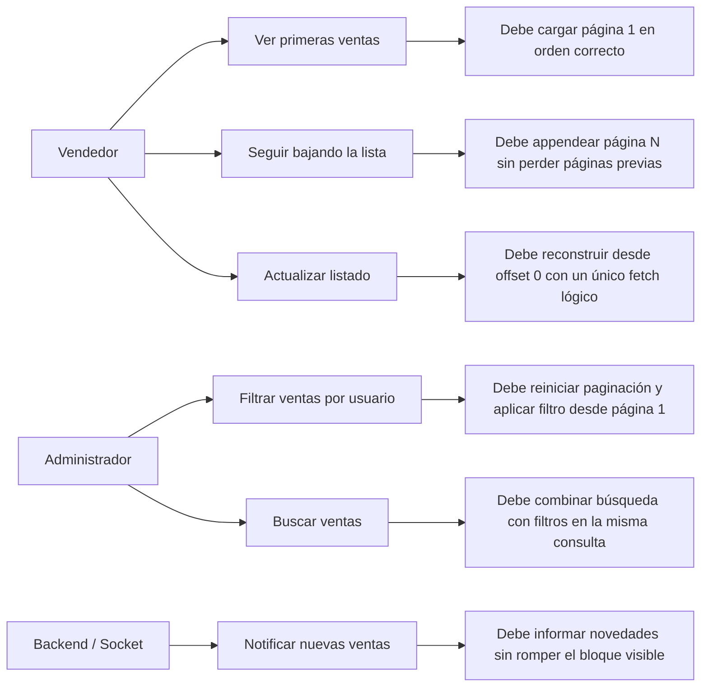
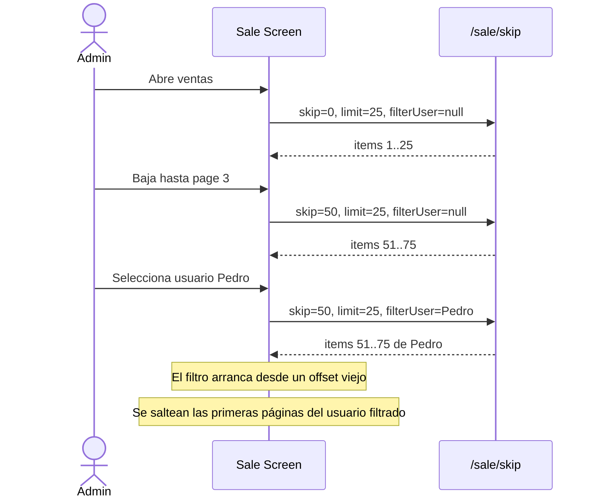
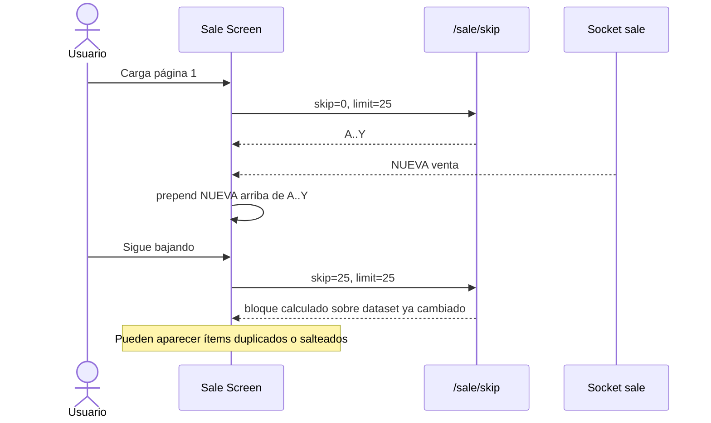
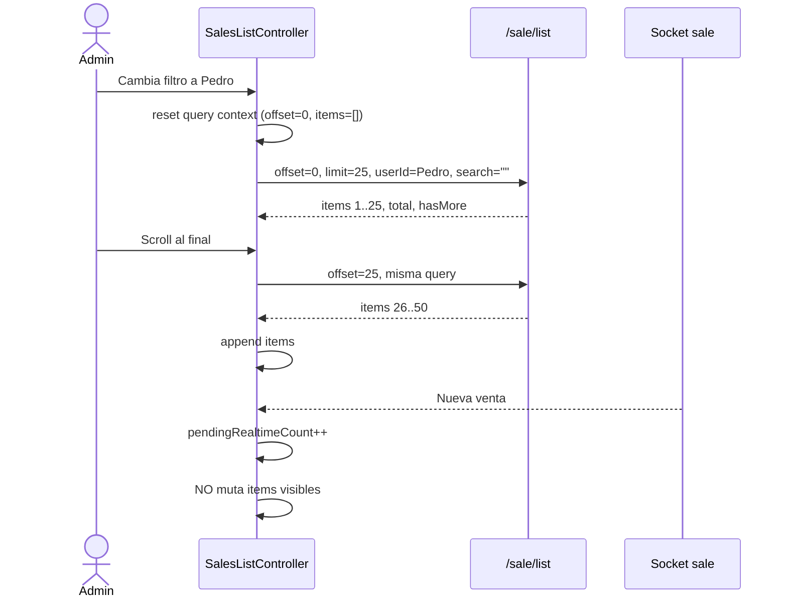
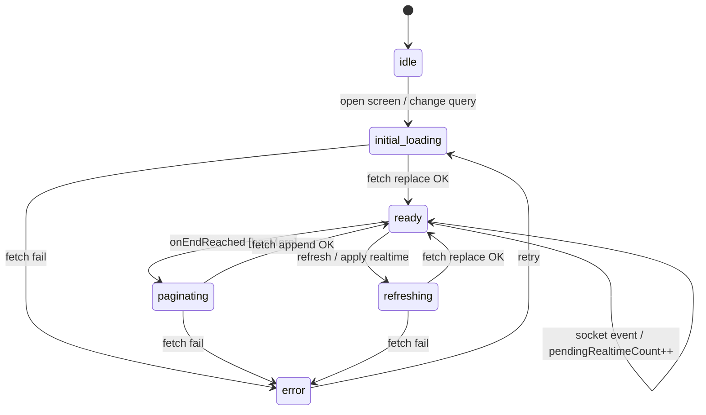

# RFC — Estabilización del listado de `Sale`

## Estado del documento

- **Tipo**: RFC técnico
- **Estado**: propuesta
- **Fecha**: 2026-04-15
- **Basado en**:
  - `src/screens/Sale.js`
  - `docs/hallazgos-sale-infinite-scroll.md`
- **Ámbito**: frontend obligatorio, backend recomendado para cerrar el modelo de consulta

> Este RFC propone cómo corregir los errores del listado de ventas (`Sale`) sin seguir parchando síntomas. La idea no es “tocar un `if` y rezar”, sino ordenar el modelo de paginación, filtros, refresh y realtime para que la lista tenga un comportamiento PREDECIBLE.

---

## 1. Resumen ejecutivo

La pantalla `Sale` hoy mezcla varias estrategias incompatibles:

- paginación por `skip/limit`
- filtro por usuario con comportamiento distinto al listado general
- búsqueda en un flujo separado
- refresh disparado por más de una fuente
- inserciones realtime al inicio de la lista mientras el usuario sigue paginando

Eso explica el síntoma reportado: **al bajar, en algunos casos la lista no carga los ítems esperados o parece saltearse bloques**.

### Decisiones principales de este RFC

1. **Mantener paginación por offset en esta iteración** para minimizar costo de migración.
2. **Unificar el listado server-side bajo un único modelo de consulta**: búsqueda, filtro por usuario y paginación deben vivir en el mismo flujo.
3. **Resetear paginación e ítems cada vez que cambia la consulta**.
4. **Appendear páginas solo cuando la consulta es la misma**.
5. **No insertar ventas nuevas por socket directamente arriba mientras la lista está paginada**; se deben bufferizar y aplicar mediante refresh.
6. **Centralizar el estado del listado** en un controlador único, en vez de dispersarlo entre varios `useState` y efectos con responsabilidades cruzadas.

---

## 2. Problema

### Problema visible para negocio

La pantalla de ventas deja de ser confiable cuando el usuario:

- baja varias páginas
- aplica un filtro
- refresca
- recibe novedades realtime
- o combina esas acciones

Para un módulo comercial eso es grave. ¿Y sabés por qué? Porque una lista de ventas no es decoración: es una herramienta operativa. Si el operador pierde confianza en el orden o en la completitud de los datos, el flujo entero se degrada.

### Evidencia técnica verificada

1. **Con filtro por usuario, `getSale` reemplaza la lista** en vez de acumular nuevas páginas.
   - `src/screens/Sale.js:147-150`
2. **Al cambiar `selectedUser`, no se reinicia `query.skip`**.
   - selección de usuario en `src/screens/Sale.js:569-575`
3. **La lista pagina por offset, pero el socket hace prepend directo** con `[socket.data, ...prevData]`.
   - `src/screens/Sale.js:242-261`
4. **El refresh dispara fetch manual y además cambia estado que vuelve a disparar fetch**.
   - `src/screens/Sale.js:236-240` y `src/screens/Sale.js:522-528`
5. **La búsqueda usa otro flujo (`dataSearch`) y no comparte contrato con la paginación principal**.
   - `src/screens/Sale.js:178-195`, `src/screens/Sale.js:213-228`, `src/screens/Sale.js:634`
6. **`FlatList` en `Sale` no define `onEndReachedThreshold`**, a diferencia de otras listas estables del proyecto.
   - `src/screens/Client.js:298-308`
   - `src/screens/Users.js:239-249`

---

## 3. Objetivos

## 3.1 Objetivos funcionales

1. Garantizar que el infinite scroll acumule páginas correctamente.
2. Garantizar que cambiar filtro o búsqueda reinicie la consulta desde la primera página.
3. Garantizar que refresh reconstruya la lista desde una única fuente de verdad.
4. Garantizar que las ventas nuevas por socket no rompan el orden ni el offset de la lista visible.
5. Permitir que búsqueda y filtro por usuario sean compatibles entre sí.

## 3.2 Objetivos técnicos

1. Reducir el número de estados redundantes del listado.
2. Hacer explícitas las transiciones de carga: initial load, refresh, paginate, error.
3. Evitar fetches duplicados y ramas lógicas contradictorias.
4. Dejar una base extensible para futuras mejoras sin rehacer la pantalla otra vez.

---

## 4. No objetivos

Este RFC **no** busca en esta iteración:

- migrar todo el módulo de ventas a cursor pagination
- rediseñar `SaleItem`
- rehacer el modo offline/local completo
- cambiar el contrato de sockets del backend más allá de cómo se consumen en la lista
- tocar impresión/PDF u otras acciones laterales del screen

---

## 5. Casos de uso afectados

## 5.1 Mapa de casos de uso



## 5.2 Caso afectado hoy — Scroll + filtro por usuario



## 5.3 Caso afectado hoy — Scroll + socket en medio de la paginación



## 5.4 Comportamiento propuesto



---

## 6. Diagnóstico de arquitectura

El problema central no es `FlatList`. El problema es que la pantalla `Sale` hoy mezcla **estado de consulta**, **estado de red**, **estado de UI**, **eventos realtime** y **modos de listado** sin una máquina de estados clara.

### Señales de deuda técnica

- dos fuentes de datos server-side (`data` y `dataSearch`)
- control manual de offset con reglas distintas según el caso
- refresh con doble disparador
- socket con efecto dependiente de `data`
- lógica de “replace vs append” escondida dentro del fetch

Eso deja una pantalla difícil de razonar, difícil de probar y fácil de romper.

---

## 7. Propuesta

## 7.1 Decisión de arquitectura

Se propone introducir un **controlador único del listado** (hook o reducer) que sea la fuente de verdad del modo server-side.

### Responsabilidades del controlador

- administrar la consulta activa
- saber si debe reemplazar o appendear resultados
- exponer el estado de carga correcto
- bufferizar eventos realtime
- ofrecer acciones explícitas:
  - `loadInitial()`
  - `applyQueryChanges()`
  - `loadNextPage()`
  - `refresh()`
  - `applyRealtimeUpdates()`

### Resultado esperado

La pantalla deja de depender de múltiples efectos con condiciones cruzadas y pasa a depender de una lógica transaccional y centralizada.

---

## 7.2 Modelo de datos propuesto

### Consulta activa

```ts
type SalesListQuery = {
  mode: 'server' | 'local'
  offset: number
  limit: number
  search: string
  userId: string | null
  sort: 'createdAt:desc'
}
```

### Estado del listado

```ts
type SalesListState = {
  items: Sale[]
  total: number
  hasMore: boolean
  status: 'idle' | 'initial-loading' | 'ready' | 'paginating' | 'refreshing' | 'error'
  error: string | null
  pendingRealtimeCount: number
  queryKey: string
}
```

### Qué desaparece del screen actual

- `data`
- `dataSearch`
- `limitSales` como estado separado de la consulta
- lógica de replace/append escondida en `getSale`

### Qué se mantiene separado

- modo local/offline (`saleStorage`) puede seguir existiendo como dataset aparte
- acciones de impresión/PDF
- permisos

---

## 7.3 Contrato de API propuesto

### Recomendación

Unificar la consulta server-side en un solo endpoint lógico. Puede implementarse de dos formas:

1. **Preferida**: crear `POST /sale/list`
2. **Transicional**: extender `POST /sale/skip` para aceptar también búsqueda

### Request

```json
{
  "offset": 0,
  "limit": 25,
  "userId": "64f...",
  "search": "pedro",
  "sort": "createdAt:desc"
}
```

### Response

```json
{
  "items": [],
  "total": 120,
  "hasMore": true,
  "nextOffset": 25
}
```

### Por qué esta decisión

Porque hoy el frontend tiene un listado paginado por un lado y una búsqueda no paginada por otro. Eso rompe el modelo mental del componente. Un listado serio necesita una sola definición de consulta.

---

## 7.4 Reglas de transición

## 7.4.1 Cuándo reemplazar la lista

Se debe **reemplazar** `items` cuando ocurre cualquiera de estos eventos:

- carga inicial
- cambio de usuario filtrado
- cambio del término de búsqueda
- refresh manual
- aplicación de novedades realtime mediante recarga
- cambio entre modo local y server

## 7.4.2 Cuándo appendear

Se debe **appendear** solo cuando:

- la consulta actual no cambió (`queryKey` igual)
- el usuario pidió la siguiente página
- `hasMore === true`
- el estado actual es `ready`

## 7.4.3 Matriz de comportamiento

| Evento | Acción | Resultado esperado |
| --- | --- | --- |
| Abrir pantalla | replace | carga página 1 |
| Scroll al final | append | suma página siguiente |
| Cambiar usuario | reset + replace | vuelve a página 1 del usuario |
| Cambiar búsqueda | reset + replace | vuelve a página 1 de esa búsqueda |
| Refresh | reset + replace | reconstruye desde offset 0 |
| Socket: nueva venta | buffer | no altera el bloque visible |
| Aplicar novedades | replace | refresca la consulta actual |

---

## 7.5 Estrategia realtime propuesta

### Decisión

Mientras el usuario está navegando la lista server-side, **no se deben prependear ítems directamente en `items`**.

### En su lugar

1. llega evento `sale`
2. se incrementa `pendingRealtimeCount`
3. se muestra un CTA visual, por ejemplo:
   - “Hay 3 ventas nuevas. Actualizar”
4. al aceptar, se hace `refresh()` de la consulta actual

### Tradeoff

#### Ventaja

- no rompe la paginación por offset
- comportamiento estable y razonable

#### Costo

- la lista no refleja realtime instantáneo en el medio del scroll

Ese costo es aceptable para esta iteración. Lo contrario —mezclar prepend en vivo con offset pagination— ya vimos que es una locura cósmica.

---

## 7.6 Configuración propuesta de `FlatList`

La lista server-side debe configurarse explícitamente con:

- `data={state.items}`
- `onEndReachedThreshold={0.5}`
- `onEndReached={loadNextPage}`
- `ListFooterComponent` para el estado `paginating`
- `refreshing={state.status === 'refreshing'}` si se adopta pull-to-refresh
- `ListEmptyComponent` coherente con `initial-loading`, `ready` y `error`

### Guardas mínimas para `onEndReached`

`loadNextPage()` solo debe dispararse si:

- `mode === 'server'`
- `status === 'ready'`
- `hasMore === true`
- `pendingRealtime refresh` no está corriendo

---

## 7.7 Máquina de estados propuesta



Este diagrama es importante porque ordena algo que hoy está implícito y mezclado. Si el equipo no define estados, después aparecen parches. Y después se preguntan por qué todo se rompe. Es así de fácil.

---

## 8. Alternativas consideradas

## 8.1 Alternativa A — Parche mínimo solo en frontend

### Qué haría

- resetear `skip` al cambiar usuario
- appendear páginas filtradas
- agregar `onEndReachedThreshold`
- evitar doble refresh
- sacar prepend del socket

### Ventajas

- menor costo inicial
- casi sin cambios de backend

### Desventajas

- mantiene dos flujos distintos (`data` vs `dataSearch`)
- no resuelve bien búsqueda + filtro como una sola consulta
- deja la pantalla con más deuda estructural

### Veredicto

**No elegida como diseño objetivo**, aunque algunas de sus medidas pueden formar parte de una etapa transicional.

## 8.2 Alternativa B — Unificación del listado con offset estable y realtime bufferizado

### Qué hace

- unifica búsqueda, filtro y paginación en un solo flujo
- mantiene offset/limit por compatibilidad
- mueve realtime a un buffer + refresh explícito

### Ventajas

- costo razonable
- corrige los bugs centrales
- mejora la arquitectura sin exigir rediseño total del backend

### Desventajas

- requiere coordinación frontend/backend si se unifica endpoint
- offset sigue siendo menos robusto que cursor ante datasets muy mutables

### Veredicto

**Elegida para esta RFC.**

## 8.3 Alternativa C — Migrar a cursor pagination

### Ventajas

- modelo más robusto frente a inserciones concurrentes
- mejor semántica para listas ordenadas por fecha

### Desventajas

- mayor cambio de backend y contrato
- más costo de QA y rollout
- no es necesario para corregir el problema actual en primera iteración

### Veredicto

**Diferida** como mejora futura, no como requisito para estabilizar el listado hoy.

---

## 9. Plan de implementación propuesto

## Fase 1 — Consolidación del estado del listado

- crear controlador único del listado server-side
- remover `dataSearch` como fuente paralela del render principal
- definir `status`, `items`, `hasMore`, `pendingRealtimeCount`, `query`

## Fase 2 — Unificación de consulta server-side

- extender backend para aceptar búsqueda y filtro por usuario en la misma consulta
- devolver `items`, `total`, `hasMore`, `nextOffset`

## Fase 3 — Realtime seguro

- reemplazar prepend directo por buffer de novedades
- agregar CTA para aplicar refresh

## Fase 4 — Ajuste de UI y list contract

- `onEndReachedThreshold={0.5}`
- footer loading
- empty states y error states coherentes
- refresh desde una sola ruta de ejecución

## Fase 5 — Verificación manual

- ejecutar matriz de casos críticos
- validar con usuario admin y usuario vendedor

---

## 10. Criterios de aceptación

1. Al bajar la lista sin filtros, cada página nueva se agrega a la anterior sin duplicados ni saltos visibles.
2. Al cambiar el filtro de usuario después de haber paginado, la consulta vuelve a `offset=0`.
3. Al paginar con filtro activo, la lista filtrada acumula páginas en vez de reemplazarlas.
4. Al refrescar, solo existe un fetch lógico y la lista se reconstruye desde la primera página.
5. Si llega una venta nueva por socket mientras el usuario está en mitad del scroll, el listado visible no cambia de orden automáticamente.
6. Búsqueda + filtro por usuario deben poder convivir dentro de la misma consulta server-side.
7. `FlatList` debe tener threshold explícito y guardas claras para evitar disparos redundantes.

---

## 11. Plan de verificación manual

| Caso | Precondición | Acción | Resultado esperado |
| --- | --- | --- | --- |
| 1. Scroll base | Usuario online | bajar hasta 4 páginas | se acumulan 100 ítems esperados |
| 2. Filtro después de scroll | lista en página 3 | seleccionar vendedor | vuelve a página 1 del vendedor |
| 3. Scroll con filtro | filtro activo | bajar 2 páginas | se acumulan páginas del filtro |
| 4. Refresh | lista con varias páginas | tocar refresh | una sola reconstrucción desde offset 0 |
| 5. Socket en scroll | usuario en página 2 | recibir venta nueva | aparece CTA, no reorder inmediato |
| 6. Aplicar novedades | CTA visible | tocar actualizar | lista recarga desde consulta actual |
| 7. Búsqueda + filtro | filtro activo | escribir búsqueda | consulta combinada desde página 1 |
| 8. Modo local | showLocal activo | cambiar a servidor | reconstruye query server sin residuos |

---

## 12. Riesgos y mitigaciones

## Riesgo 1 — Backend no puede unificar búsqueda en esta iteración

### Mitigación

- hacer una etapa transicional con adapter frontend
- pero mantener el diseño del controlador listo para la unificación real

## Riesgo 2 — Duplicados por respuestas repetidas o carreras de red

### Mitigación

- deduplicar por `_id` al append
- ignorar respuestas cuya `queryKey` ya no coincida con la consulta activa

## Riesgo 3 — Cambios de socket mientras el usuario cambia filtros

### Mitigación

- socket desacoplado del array visible
- solo incrementa contador de novedades

## Riesgo 4 — Regresiones en offline/local mode

### Mitigación

- mantener separado el dataset local
- no reutilizar guardas de server para modo offline

---

## 13. Impacto en archivos

### Frontend seguro

- `src/screens/Sale.js` — principal refactor
- posible nuevo `src/hooks/useSalesListController.js` o `src/features/sale/useSalesListController.js`
- posible nuevo componente presentacional para la lista server-side

### Backend recomendado

- endpoint de listado de ventas para aceptar query unificada

---

## 14. Decisión final

Se aprueba como dirección técnica:

1. **estabilizar el listado con un controlador único de estado**
2. **mantener offset/limit en esta iteración**
3. **unificar búsqueda, filtro y paginación en una sola consulta**
4. **mover realtime a un modelo de buffer + refresh explícito**

Esta decisión tiene el mejor balance entre:

- costo de implementación
- reducción de bugs reales
- claridad arquitectónica
- menor riesgo de romper el módulo completo

---

## 15. Siguiente paso recomendado

Convertir este RFC en un plan de implementación por tareas, por ejemplo:

1. diseño del controlador del listado
2. cambios de contrato frontend/backend
3. migración del render a una sola fuente de datos
4. ajuste del socket y refresh
5. validación manual por matriz de casos

Si no hacemos ese desglose, pasa lo de siempre: el RFC queda lindo, pero nadie aterriza el trabajo. Y la arquitectura no se arregla sola, hermano.
