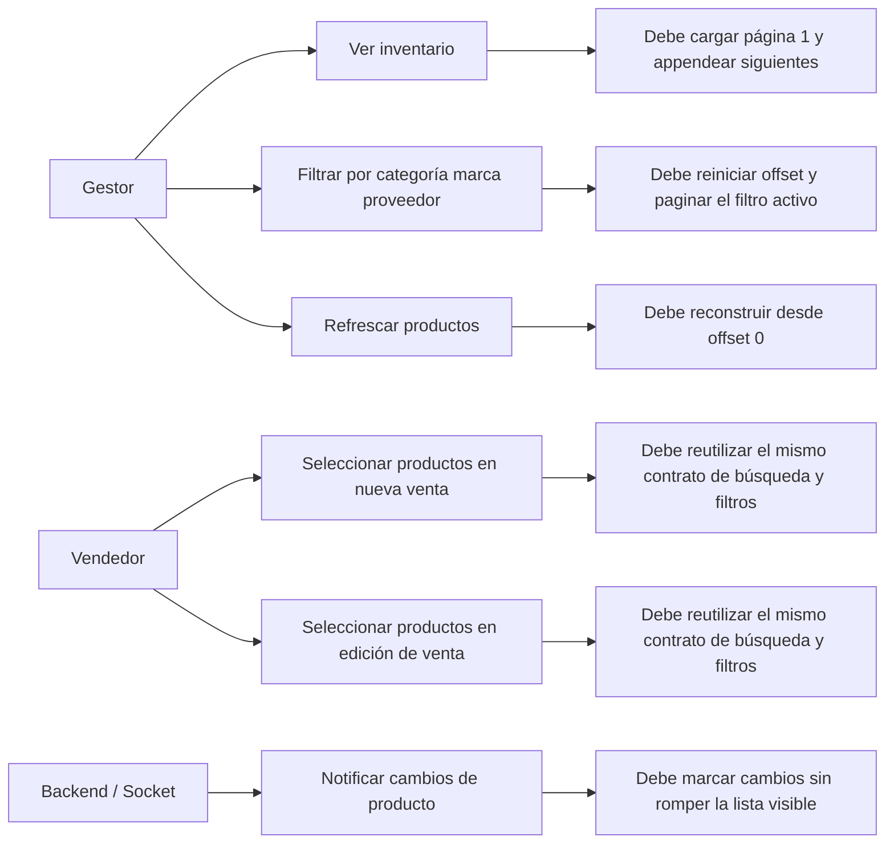
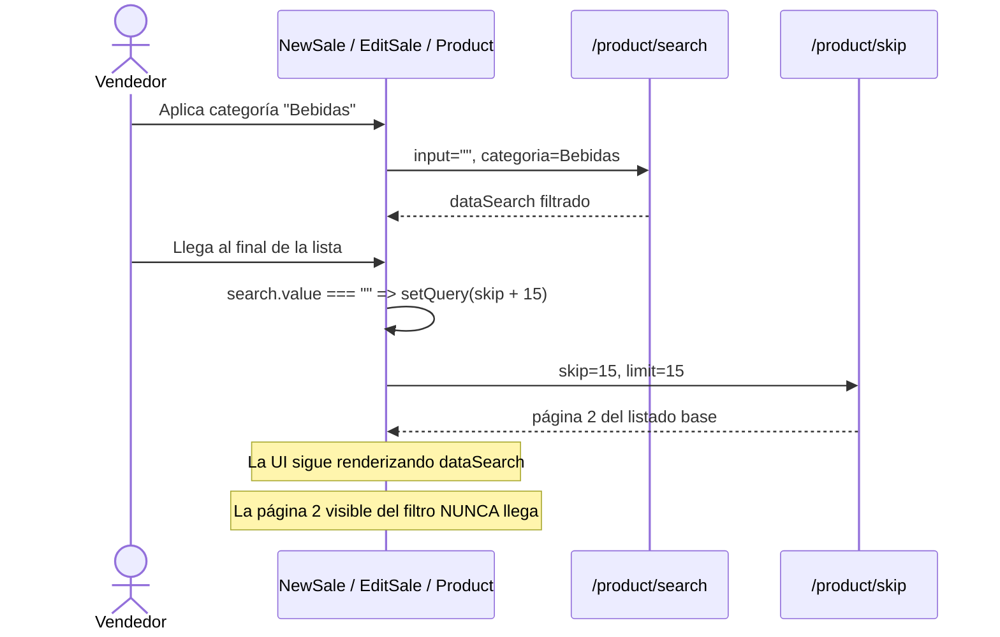
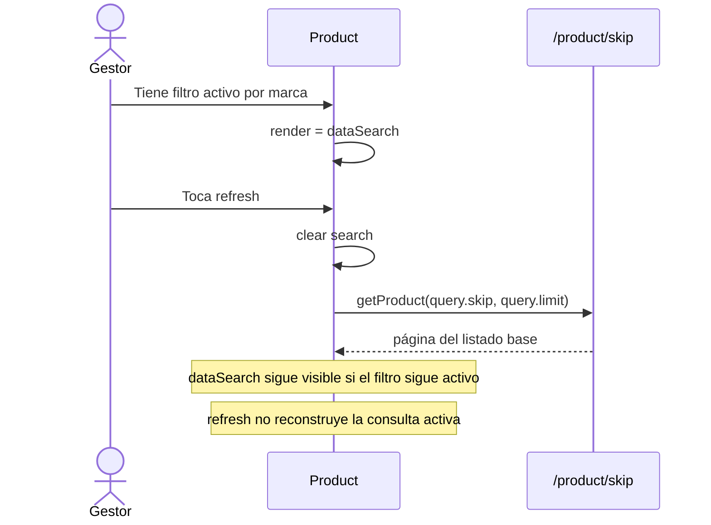
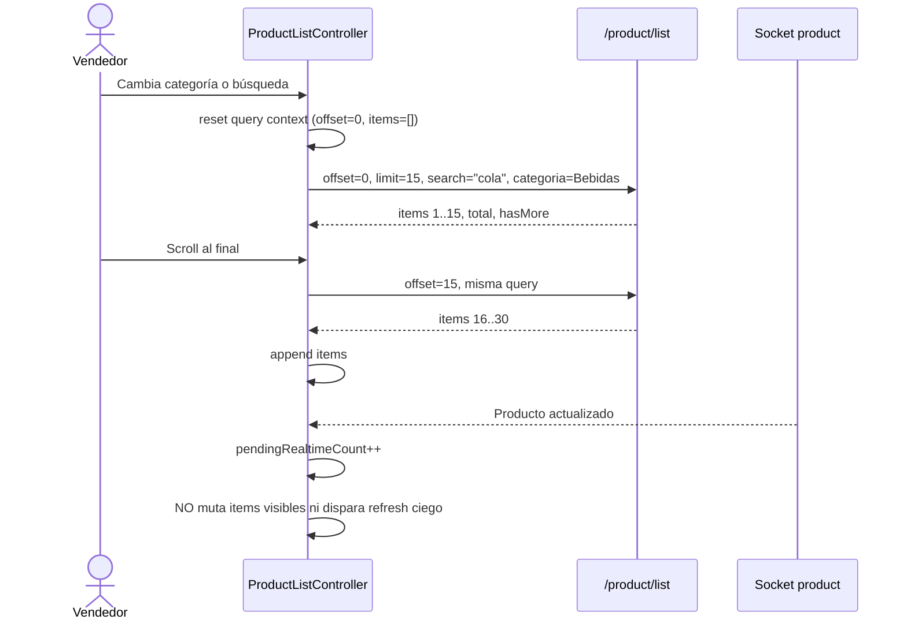

# RFC — Fix listas 002: estabilización del listado de productos y selectores de venta

## Estado del documento

- **Tipo**: RFC técnico
- **Estado**: propuesta
- **Fecha**: 2026-04-23
- **Basado en**:
  - `docs/RFC-fix-listas-001-sale.md`
  - `src/screens/Product.js`
  - `src/screens/NewSale.js`
  - `src/screens/EditSale.js`
- **Ámbito**: frontend obligatorio, backend recomendado para cerrar el modelo de consulta

> Este RFC propone corregir el modelo de listado de productos y de selección de productos reutilizado en `Product`, `NewSale` y `EditSale`. El objetivo no es seguir parchando tres pantallas que comparten la misma deuda, sino consolidar un solo contrato de consulta para búsqueda, filtros, paginación, refresh y socket.

---

## 1. Resumen ejecutivo

Hoy existen tres pantallas distintas que en realidad usan el mismo problema duplicado:

- listado de productos general (`Product`)
- selector de productos para nueva venta (`NewSale`)
- selector de productos para edición de venta (`EditSale`)

Las tres mezclan estrategias incompatibles:

- paginación por `skip/limit`
- búsqueda y filtros por un flujo paralelo (`dataSearch`)
- refresh que no reconstruye la consulta activa
- sockets que fuerzan refresh sobre una lista paginada sin respetar contexto
- modo offline/local mezclado con modo server-side sin un controlador explícito

Eso genera síntomas visibles:

- filtros activos que no pueden paginar correctamente
- refresh que aparenta actualizar pero no recompone la lista
- páginas invisibles cargadas en background mientras la UI sigue mostrando `dataSearch`
- selectores de producto inconsistentes entre `Product`, `NewSale` y `EditSale`

### Decisiones principales de este RFC

1. **Mantener paginación por offset en esta iteración** para minimizar costo de migración.
2. **Unificar búsqueda, filtros y paginación en un único modelo de consulta server-side**.
3. **Crear un controlador compartido de productos** reutilizable por `Product`, `NewSale` y `EditSale`.
4. **Resetear offset e items cada vez que cambie la consulta activa**.
5. **Appendear solo cuando la consulta visible es exactamente la misma**.
6. **Desacoplar los eventos de socket del array visible**; el socket debe invalidar o bufferizar, no refrescar a ciegas una lista paginada.
7. **Mantener el modo offline/local como dataset separado**, no como una rama escondida dentro del mismo flujo server-side.

---

## 2. Problema

### Problema visible para negocio

Cuando el operador busca, filtra o pagina productos, la lista puede dejar de representar lo que la UI dice que está consultando. Y eso en ventas es grave.

¿Por qué? Porque acá la lista no es decoración: es la base de la operación. Si el vendedor no puede confiar en que está viendo todos los productos del filtro actual, o si el selector de productos se queda con resultados viejos mientras arma una venta, el flujo entero se vuelve poco confiable.

### Evidencia técnica verificada

1. **Las tres pantallas mantienen dos fuentes server-side separadas: `data` y `dataSearch`.**
   - `src/screens/Product.js:84-90`
   - `src/screens/NewSale.js:89-95`
   - `src/screens/EditSale.js:89-95`

2. **La consulta base pagina por `skip/limit`, pero búsqueda y filtros viven en otro endpoint (`/product/search`) y otro estado (`dataSearch`).**
   - `src/screens/Product.js:121-179`
   - `src/screens/NewSale.js:121-168`
   - `src/screens/EditSale.js:155-201`

3. **Con filtros activos y búsqueda vacía, la UI renderiza `dataSearch`, pero `onEndReached` sigue avanzando `query.skip` solo porque `search.value === ''`.**
   - `src/screens/Product.js:299-317`
   - `src/screens/NewSale.js:505-520`
   - `src/screens/EditSale.js:567-583`

   Resultado: la lista visible NO pagina la consulta filtrada; pagina un dataset base que ni siquiera se está renderizando.

4. **El refresh limpia búsqueda, pero NO resetea offset ni items; además vuelve a pedir la página actual del listado base.**
   - `src/screens/Product.js:212-217`
   - `src/screens/NewSale.js:192-195`
   - `src/screens/EditSale.js:230-233`

5. **`getProduct` siempre appenda por deduplicación y nunca reemplaza el listado para una reconstrucción real.**
   - `src/screens/Product.js:121-140`
   - `src/screens/NewSale.js:121-138`
   - `src/screens/EditSale.js:155-172`

6. **El socket de productos dispara refresh sobre una lista paginada y el efecto depende de `data`, recreando la conexión cada vez que cambia el array.**
   - `src/screens/Product.js:193-210`
   - `src/screens/NewSale.js:182-190`
   - `src/screens/EditSale.js:220-228`

7. **Las tres `FlatList` no definen `onEndReachedThreshold`, a diferencia de las listas administrativas más estables del proyecto.**
   - `src/screens/Product.js:297-317`
   - `src/screens/NewSale.js:502-521`
   - `src/screens/EditSale.js:565-584`
   - comparación: `src/screens/Client.js:298-308`, `src/screens/Users.js:239-249`, `src/screens/Roles.js:246-256`

---

## 3. Objetivos

## 3.1 Objetivos funcionales

1. Garantizar que el infinite scroll acumule páginas del query realmente visible.
2. Garantizar que filtros por categoría, marca y proveedor puedan convivir con búsqueda y paginación.
3. Garantizar que refresh reconstruya la consulta desde `offset=0`.
4. Garantizar que `Product`, `NewSale` y `EditSale` compartan el mismo comportamiento de lista.
5. Garantizar que el socket no rompa la consistencia de la consulta visible.
6. Mantener el modo offline/local aislado del modo server-side.

## 3.2 Objetivos técnicos

1. Remover `dataSearch` como segunda fuente principal de render.
2. Consolidar el estado del listado en un hook o reducer compartido.
3. Hacer explícitos los estados: carga inicial, refresh, paginación, error, datos stale por socket.
4. Evitar efectos cruzados distintos por pantalla para el mismo dominio.
5. Dejar base reutilizable para otras listas paginadas del proyecto.

---

## 4. No objetivos

Este RFC **no** busca en esta iteración:

- rediseñar `AddProduct`, `CartSale` o la UI del carrito
- cambiar impresión/PDF o bottom sheets de ventas
- rehacer todo el módulo offline de productos o ventas
- redefinir el dominio de stock en backend
- introducir cursor pagination todavía
- resolver validaciones finales de stock al confirmar la venta dentro del listado mismo

---

## 5. Casos de uso afectados

## 5.1 Mapa de casos de uso



## 5.2 Caso afectado hoy — Filtro activo + scroll



## 5.3 Caso afectado hoy — Refresh con filtro activo



## 5.4 Comportamiento propuesto



---

## 6. Diagnóstico de arquitectura

El problema central no es `FlatList`. El problema es que el dominio "consultar productos" está duplicado tres veces y cada pantalla mezcla:

- estado de consulta
- estado de red
- estado de UI
- modo offline/local
- eventos de socket
- contexto de venta

sin una máquina de estados compartida.

### Señales de deuda técnica

- dos datasets server-side (`data` y `dataSearch`)
- control manual de offset desconectado del dataset visible
- refresh que no reemplaza ni resetea
- socket recreado por cambios en `data`
- tres pantallas duplicando el mismo patrón roto

Eso deja un comportamiento difícil de razonar y todavía peor: cada parche que se haga en una pantalla obliga a acordarse de las otras dos.

---

## 7. Propuesta

## 7.1 Decisión de arquitectura

Se propone introducir un **controlador compartido del listado de productos** (`useProductListController`) como fuente de verdad del modo server-side para `Product`, `NewSale` y `EditSale`.

### Responsabilidades del controlador

- administrar la consulta activa
- saber cuándo reemplazar y cuándo appendear
- exponer estados de carga coherentes
- desacoplar socket del array visible
- tolerar respuestas viejas o fuera de orden
- ofrecer acciones explícitas:
  - `loadInitial()`
  - `applyQueryChanges()`
  - `loadNextPage()`
  - `refresh()`
  - `markRealtimePending()`
  - `applyPendingChanges()`

### Resultado esperado

Las tres pantallas dejan de implementar su propia lógica ad hoc y pasan a consumir el mismo contrato de datos.

---

## 7.2 Modelo de datos propuesto

### Consulta activa

```ts
type ProductListQuery = {
  mode: 'server' | 'local'
  offset: number
  limit: number
  search: string
  categoryId: string | number | null
  brandId: string | number | null
  providerId: string | number | null
}
```

### Estado del listado

```ts
type ProductListState = {
  items: Product[]
  total: number
  hasMore: boolean
  status: 'idle' | 'initial-loading' | 'ready' | 'paginating' | 'refreshing' | 'error'
  error: string | null
  pendingRealtimeCount: number
  queryKey: string
}
```

### Qué desaparece del screen actual

- `data`
- `dataSearch`
- reglas locales distintas por pantalla para `setQuery`
- `refreshProducts()` con semántica ambigua

### Qué se mantiene separado

- carrito y línea de venta
- modal de agregar producto
- impresión/PDF
- dataset offline/local (`productStorage`)

---

## 7.3 Contrato de API propuesto

### Recomendación

Unificar la consulta server-side en un solo endpoint lógico. Puede implementarse de dos formas:

1. **Preferida**: crear `POST /product/list`
2. **Transicional**: extender `POST /product/skip` para aceptar también búsqueda y filtros

### Request

```json
{
  "offset": 0,
  "limit": 15,
  "search": "cola",
  "categoryId": "64f...",
  "brandId": "64a...",
  "providerId": null
}
```

### Response

```json
{
  "items": [],
  "total": 84,
  "hasMore": true,
  "nextOffset": 15
}
```

### Por qué esta decisión

Porque hoy el frontend tiene una lista paginada por un lado y una lista filtrada no paginada por otro. Eso rompe el modelo mental del componente. Si la consulta visible no tiene una sola definición, el scroll siempre termina mintiendo.

---

## 7.4 Reglas de transición

## 7.4.1 Cuándo reemplazar la lista

Se debe **reemplazar** `items` cuando ocurre cualquiera de estos eventos:

- carga inicial
- cambio de búsqueda
- cambio de categoría, marca o proveedor
- refresh manual
- aplicación de cambios pendientes por socket
- cambio entre modo local y server
- reingreso a la pantalla si se decide reconstruir la consulta activa

## 7.4.2 Cuándo appendear

Se debe **appendear** solo cuando:

- la consulta actual no cambió (`queryKey` igual)
- el usuario pidió la siguiente página
- `hasMore === true`
- el estado actual es `ready`
- la pantalla está en modo `server`

## 7.4.3 Matriz de comportamiento

| Evento | Acción | Resultado esperado |
| --- | --- | --- |
| Abrir Product/NewSale/EditSale | replace | carga página 1 |
| Scroll al final | append | suma la página siguiente de la consulta visible |
| Cambiar categoría | reset + replace | vuelve a página 1 filtrada |
| Cambiar marca/proveedor | reset + replace | vuelve a página 1 filtrada |
| Cambiar búsqueda | reset + replace | vuelve a página 1 de esa búsqueda |
| Refresh | reset + replace | reconstruye desde offset 0 |
| Socket product | buffer/invalidate | no rompe la lista visible |
| Modo local | dataset separado | no reutiliza guardas server-side |

---

## 7.5 Estrategia realtime propuesta

### Decisión

Mientras el usuario navega una lista paginada de productos, **el socket no debe disparar refresh ciego ni mutar `items` visibles automáticamente**.

### En su lugar

1. llega evento `product`
2. el controlador incrementa `pendingRealtimeCount`
3. la UI muestra señal de datos potencialmente desactualizados
4. al aceptar, se hace `refresh()` de la consulta activa

### Tradeoff

#### Ventaja

- no rompe el contexto de paginación
- evita conexiones recreadas por cada cambio de `data`
- evita invalidar silenciosamente el selector de productos mientras el usuario vende

#### Costo

- el listado no refleja cambios de producto en tiempo real de forma instantánea

Ese costo es aceptable en esta iteración. Si negocio necesita validar stock o precio al confirmar una venta, eso debe resolverse al guardar, no forzando mutaciones mágicas en la lista.

---

## 7.6 Configuración propuesta de `FlatList`

La lista server-side debe configurarse explícitamente con:

- `data={state.items}`
- `onEndReachedThreshold={0.5}`
- `onEndReached={loadNextPage}`
- `ListFooterComponent` para `paginating`
- `ListEmptyComponent` coherente con `initial-loading`, `ready` y `error`
- `refreshing={state.status === 'refreshing'}` cuando la pantalla use pull-to-refresh

### Guardas mínimas para `onEndReached`

`loadNextPage()` solo debe dispararse si:

- `mode === 'server'`
- `status === 'ready'`
- `hasMore === true`
- no hay refresh corriendo
- no cambió el `queryKey`

---

## 7.7 Secuencia de migración propuesta

1. Implementar `useProductListController` con adapter a los endpoints actuales.
2. Migrar `Product` a una sola fuente de datos.
3. Reutilizar el mismo hook en `NewSale`.
4. Reutilizar el mismo hook en `EditSale`.
5. Reemplazar el refresh por una única ruta de ejecución.
6. Mover socket a invalidación/buffer.

---

## 8. Alternativas consideradas

## 8.1 Alternativa A — Parche por pantalla

### Qué haría

- agregar `onEndReachedThreshold`
- resetear `skip` en refresh
- corregir algunas condiciones de filtro

### Ventajas

- menor costo inicial
- cambios rápidos

### Desventajas

- repite lógica tres veces
- deja `data` y `dataSearch` vivos
- sigue sin haber contrato único de consulta

### Veredicto

**No elegida como diseño objetivo.**

## 8.2 Alternativa B — Hook compartido específico de productos

### Qué hace

- unifica búsqueda, filtros y paginación
- mantiene offset/limit
- comparte comportamiento entre `Product`, `NewSale` y `EditSale`
- bufferiza o invalida cambios por socket

### Ventajas

- corrige el problema real en el dominio correcto
- evita divergencia entre pantallas
- costo razonable

### Desventajas

- requiere refactor en tres screens
- conviene coordinación backend si se unifica endpoint

### Veredicto

**Elegida para esta RFC.**

## 8.3 Alternativa C — Hook genérico para cualquier entidad ya mismo

### Ventajas

- máxima reutilización futura

### Desventajas

- riesgo de abstraer demasiado antes de estabilizar el primer dominio reutilizable

### Veredicto

**Diferida.** Primero hay que estabilizar bien el caso productos; después se evalúa extraer una abstracción genérica.

---

## 9. Plan de implementación propuesto

## Fase 1 — Consolidación del estado

- crear `useProductListController`
- definir `query`, `status`, `items`, `hasMore`, `pendingRealtimeCount`
- encapsular `queryKey` y guardas de respuestas viejas

## Fase 2 — Unificación de consulta server-side

- adaptar backend o service para aceptar búsqueda + filtros + offset en un solo flujo
- devolver `items`, `total`, `hasMore`, `nextOffset`

## Fase 3 — Migración de pantallas

- migrar `Product`
- migrar `NewSale`
- migrar `EditSale`

## Fase 4 — Realtime seguro

- reemplazar refresh automático por invalidación/buffer
- agregar CTA o indicador de cambios pendientes

## Fase 5 — Verificación manual

- validar inventario
- validar nueva venta
- validar edición de venta
- validar modo offline/local por separado

---

## 10. Criterios de aceptación

1. Al bajar la lista sin filtros, cada página nueva se agrega a la anterior sin duplicados ni saltos visibles.
2. Al aplicar categoría, marca o proveedor, la consulta vuelve a `offset=0`.
3. Con filtros activos y búsqueda vacía, el scroll pagina el filtro visible y no el dataset base.
4. Búsqueda + filtros deben convivir en una sola consulta server-side.
5. Al refrescar, solo existe un fetch lógico y la lista se reconstruye desde la primera página.
6. `Product`, `NewSale` y `EditSale` deben compartir el mismo comportamiento de consulta.
7. Si llega un evento `product` por socket durante la navegación, la lista visible no cambia de forma silenciosa ni reconstruye la página equivocada.
8. El modo offline/local sigue funcionando como dataset separado.

---

## 11. Plan de verificación manual

| Caso | Precondición | Acción | Resultado esperado |
| --- | --- | --- | --- |
| 1. Scroll base en Product | usuario online | bajar 4 páginas | se acumulan 60 ítems esperados |
| 2. Filtro + scroll | categoría activa | bajar 2 páginas | se acumulan páginas del filtro |
| 3. Marca + búsqueda | proveedor/marca activos | escribir búsqueda | consulta combinada desde página 1 |
| 4. Refresh filtrado | filtro activo | tocar refresh | reconstrucción desde offset 0 del filtro activo |
| 5. Focus return | lista en página 3 | entrar a detalle y volver | no queda una mezcla de páginas viejas |
| 6. NewSale selector | nueva venta abierta | filtrar y paginar | mismo comportamiento que Product |
| 7. EditSale selector | edición abierta | filtrar y paginar | mismo comportamiento que Product |
| 8. Socket product | usuario en página 2 | recibir actualización | aparece señal de cambios, no refresh ciego |
| 9. Offline local | offline activo | buscar productos | usa dataset local sin guardas server-side |

---

## 12. Riesgos y mitigaciones

## Riesgo 1 — Backend no puede unificar búsqueda y filtros en esta iteración

### Mitigación

- crear adapter transicional en frontend
- pero mantener la API interna del controlador ya unificada

## Riesgo 2 — Respuestas viejas pisan la consulta actual

### Mitigación

- usar `queryKey`
- ignorar respuestas cuya consulta ya no coincida

## Riesgo 3 — Cambio de producto mientras el vendedor arma una venta

### Mitigación

- socket desacoplado del array visible
- validar stock/precio final al confirmar si negocio lo requiere

## Riesgo 4 — Regresiones entre screens porque comparten hook

### Mitigación

- testeo manual por matriz de casos
- flags explícitas para `mode: server | local`
- mantener carrito y acciones laterales fuera del hook

---

## 13. Impacto en archivos

### Frontend seguro

- `src/screens/Product.js` — principal migración de listado general
- `src/screens/NewSale.js` — migración del selector de productos
- `src/screens/EditSale.js` — migración del selector de productos en edición
- posible nuevo `src/hooks/useProductListController.js`
- posible nuevo `src/services/productListService.js`

### Backend recomendado

- endpoint de listado de productos para aceptar query unificada

---

## 14. Decisión final

Se aprueba como dirección técnica:

1. **estabilizar el dominio de lista de productos con un hook compartido**
2. **mantener offset/limit en esta iteración**
3. **unificar búsqueda, filtros y paginación en una sola consulta**
4. **desacoplar socket de la lista visible**
5. **mantener el modo local/offline separado del modo server-side**

Esta decisión tiene el mejor balance entre:

- costo de implementación
- reducción de bugs reales en tres pantallas de una sola vez
- claridad arquitectónica
- menor riesgo de seguir duplicando deuda

---

## 15. Siguiente paso recomendado

Convertir este RFC en tareas concretas, por ejemplo:

1. diseño del `useProductListController`
2. adapter transicional o contrato backend para `/product/list`
3. migración de `Product`
4. migración de `NewSale`
5. migración de `EditSale`
6. ajuste del socket e invalidación
7. validación manual por matriz de casos

Si no hacemos ese desglose, va a pasar lo mismo que siempre: tres pantallas distintas con el mismo bug maquillado distinto. Y eso no es arquitectura; es deuda con otro nombre.
