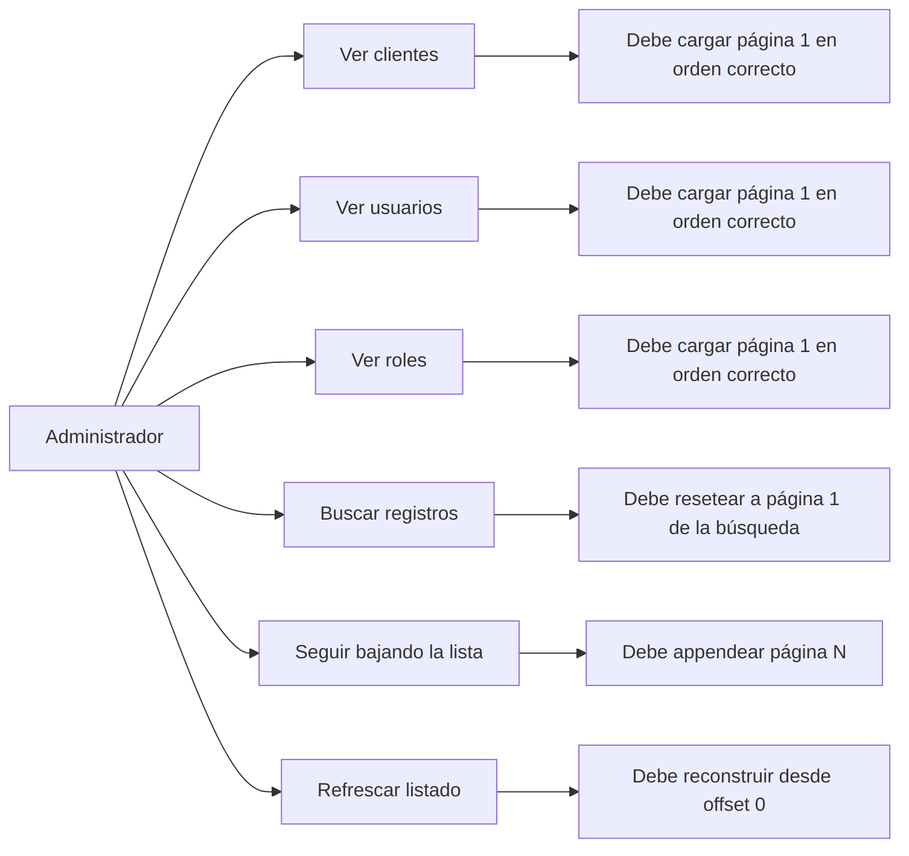
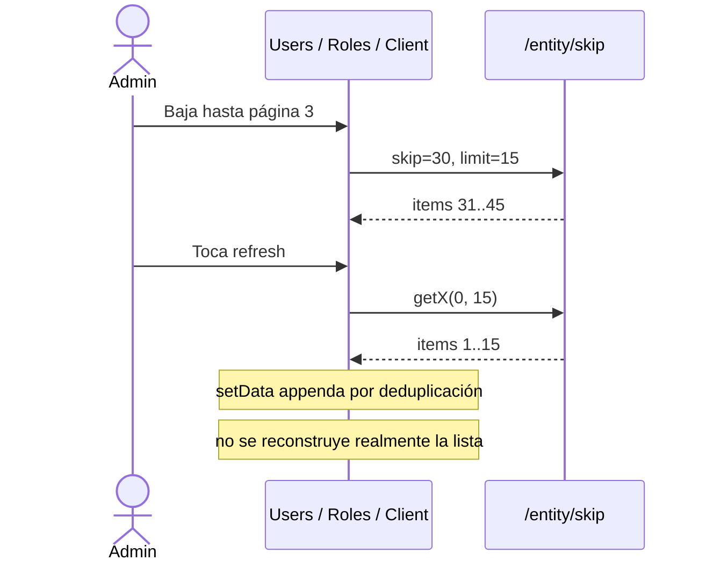
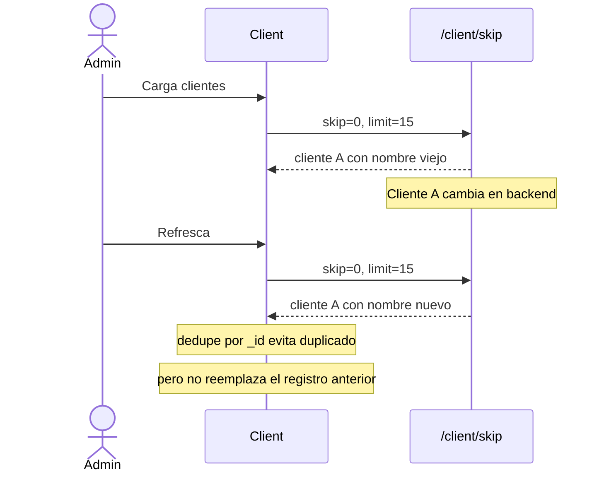
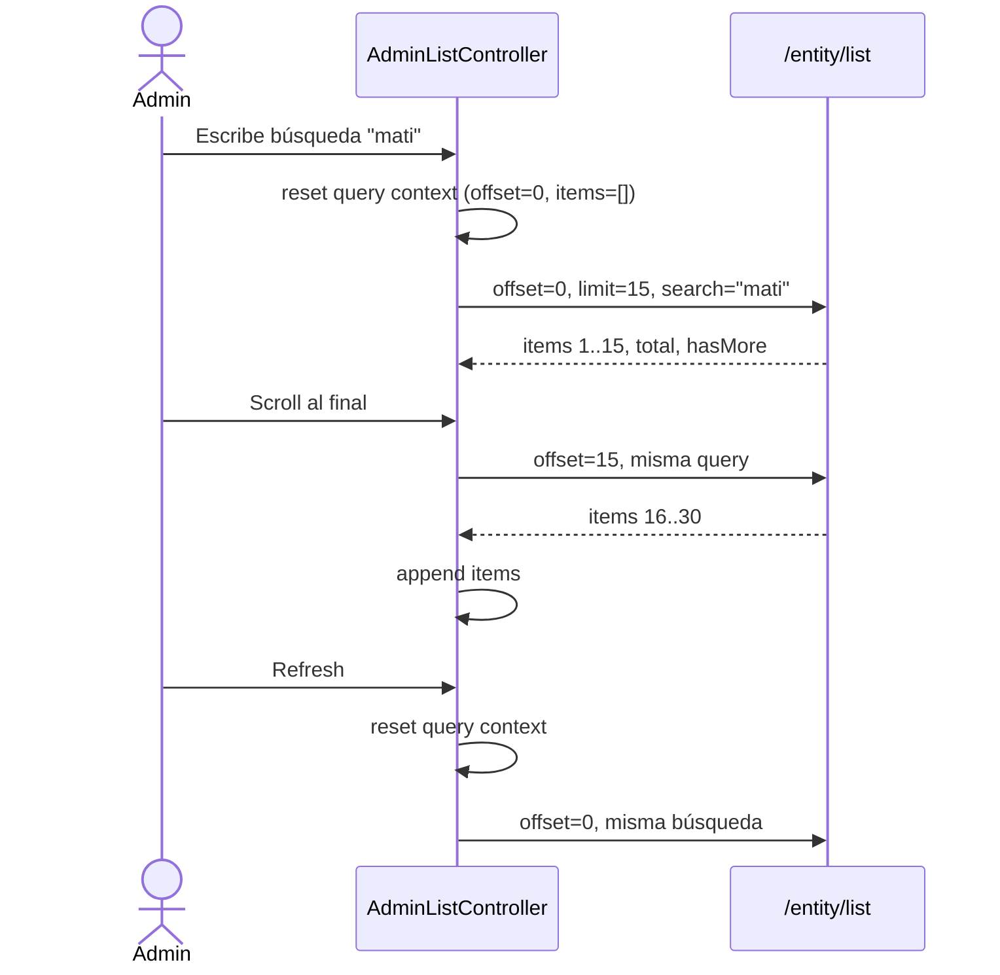

# RFC — Fix listas 003: estabilización de listas administrativas de clientes, usuarios y roles

## Estado del documento

- **Tipo**: RFC técnico
- **Estado**: propuesta
- **Fecha**: 2026-04-23
- **Basado en**:
  - `docs/RFC-fix-listas-001-sale.md`
  - `src/screens/Client.js`
  - `src/screens/Users.js`
  - `src/screens/Roles.js`
- **Ámbito**: frontend obligatorio, backend recomendado para cerrar el modelo de consulta

> Este RFC propone estabilizar el patrón de listado administrativo reutilizado por `Client`, `Users` y `Roles`. La idea no es rehacer tres pantallas CRUD por capricho, sino ordenar un modelo repetido de paginación, búsqueda y refresh que hoy parece funcionar… hasta que deja de hacerlo.

---

## 1. Resumen ejecutivo

Las pantallas `Client`, `Users` y `Roles` comparten prácticamente el mismo esqueleto:

- paginación por `skip/limit`
- búsqueda en endpoint separado
- render alternando entre `data` y `dataSearch`
- refresh que llama manualmente la página 0
- append escondido dentro del fetch

No tienen toda la complejidad realtime de `Sale`, pero sí comparten una deuda estructural importante: **la consulta visible no tiene una sola fuente de verdad**.

Eso se traduce en problemas concretos:

- refresh que no reconstruye la lista de verdad
- imposibilidad de paginar una búsqueda
- datos potencialmente stale si un registro cambió y el fetch lo deduplica sin reemplazarlo
- tres screens manteniendo el mismo patrón manual

### Decisiones principales de este RFC

1. **Mantener paginación por offset en esta iteración**.
2. **Unificar búsqueda y paginación bajo un único modelo de consulta por entidad**.
3. **Crear un controlador reutilizable para listas administrativas**.
4. **Resetear offset e items ante cambios de consulta o refresh**.
5. **Hacer explícitas las transiciones de estado**: carga inicial, refresh, paginate, error.
6. **Dejar el socket fuera del problema principal**; si se reactiva en el futuro, deberá usar invalidación y no mutación directa del array.

---

## 2. Problema

### Problema visible para negocio

En pantallas administrativas, el operador necesita algo muy simple: abrir, buscar, bajar, refrescar y confiar en que lo que ve responde a una única consulta consistente.

Hoy eso no está garantizado. El refresh puede aparentar actualización sin reconstruir nada, y la búsqueda tiene un contrato distinto de la paginación. Eso genera una UI que parece estable hasta que el usuario combina acciones.

### Evidencia técnica verificada

1. **Las tres pantallas mantienen `data` y `dataSearch` como fuentes separadas de render.**
   - `src/screens/Client.js:110-114`
   - `src/screens/Users.js:98-103`
   - `src/screens/Roles.js:88-93`

2. **La paginación usa `/skip`, pero la búsqueda usa `/search` y no comparte contrato con el scroll.**
   - `src/screens/Client.js:133-199`
   - `src/screens/Users.js:119-186`
   - `src/screens/Roles.js:109-175`

3. **El render cambia entre `data` y `dataSearch` según `search.value !== ''`, por lo que la búsqueda no pagina y la lista visible cambia de dataset.**
   - `src/screens/Client.js:278-309`
   - `src/screens/Users.js:219-250`
   - `src/screens/Roles.js:226-257`

4. **El refresh llama `getX(0, 15)`, pero no resetea `data`; como el fetch appenda por deduplicación, la reconstrucción real no existe.**
   - `src/screens/Client.js:231-235` + `145-154`
   - `src/screens/Users.js:200-204` + `131-140`
   - `src/screens/Roles.js:207-211` + `121-130`

5. **El append por deduplicación no reemplaza registros existentes si cambiaron en backend; solo evita repetir `_id`.**
   - `src/screens/Client.js:145-154`
   - `src/screens/Users.js:131-140`
   - `src/screens/Roles.js:121-130`

6. **Las tres pantallas duplican la misma lógica de fetch, refresh y paginación, aumentando el costo de cualquier fix.**
   - `src/screens/Client.js`
   - `src/screens/Users.js`
   - `src/screens/Roles.js`

---

## 3. Objetivos

## 3.1 Objetivos funcionales

1. Garantizar que el infinite scroll acumule páginas correctamente.
2. Garantizar que cambiar búsqueda reinicie la consulta desde la primera página.
3. Garantizar que refresh reconstruya la lista desde `offset=0`.
4. Garantizar que los registros actualizados en backend puedan verse al refrescar, sin quedar tapados por deduplicación ciega.
5. Unificar comportamiento entre `Client`, `Users` y `Roles`.

## 3.2 Objetivos técnicos

1. Remover `dataSearch` como segunda fuente principal del render.
2. Hacer explícitos los estados de carga del listado.
3. Evitar fetches duplicados y ramas lógicas separadas para la misma consulta.
4. Consolidar el patrón común en un hook reutilizable.
5. Dejar lista una base reusable para otras pantallas CRUD administrativas.

---

## 4. No objetivos

Este RFC **no** busca en esta iteración:

- rediseñar tarjetas o ítems visuales de cliente, usuario o rol
- rehacer permisos del módulo administrativo
- introducir realtime en estas pantallas
- migrar a cursor pagination
- rediseñar el modo offline completo

---

## 5. Casos de uso afectados

## 5.1 Mapa de casos de uso



## 5.2 Caso afectado hoy — Refresh después de paginar



## 5.3 Caso afectado hoy — Registro actualizado en página 1



## 5.4 Comportamiento propuesto



---

## 6. Diagnóstico de arquitectura

El problema central tampoco acá es `FlatList`. El problema es un patrón CRUD repetido tres veces sin una máquina de estados clara.

### Señales de deuda técnica

- dos fuentes server-side (`data` y `dataSearch`)
- refresh manual sin reset real del estado
- append escondido dentro del fetch
- búsqueda no paginada y separada del contrato principal
- tres implementaciones casi idénticas del mismo problema

Esto deja un módulo administrativo que parece simple, pero cuesta mantener porque cualquier corrección hay que acordarse de copiarla tres veces.

---

## 7. Propuesta

## 7.1 Decisión de arquitectura

Se propone introducir un **controlador reutilizable de listas administrativas** (`useAdminEntityListController` o nombre equivalente) como fuente de verdad del modo server-side para `Client`, `Users` y `Roles`.

### Responsabilidades del controlador

- administrar la consulta activa
- saber cuándo reemplazar y cuándo appendear
- exponer estados de carga correctos
- tolerar respuestas viejas o fuera de orden
- ofrecer acciones explícitas:
  - `loadInitial()`
  - `setSearch()`
  - `loadNextPage()`
  - `refresh()`
  - `retry()`

### Resultado esperado

Las tres pantallas dejan de alternar entre dos datasets y pasan a depender de una sola consulta activa, con transiciones explícitas.

---

## 7.2 Modelo de datos propuesto

### Consulta activa

```ts
type AdminEntityListQuery = {
  entity: 'client' | 'user' | 'role'
  offset: number
  limit: number
  search: string
}
```

### Estado del listado

```ts
type AdminEntityListState = {
  items: unknown[]
  total: number
  hasMore: boolean
  status: 'idle' | 'initial-loading' | 'ready' | 'paginating' | 'refreshing' | 'error'
  error: string | null
  queryKey: string
}
```

### Qué desaparece del screen actual

- `data`
- `dataSearch`
- lógica de append embebida en `getClients`, `getUsers`, `getRoles`
- refresh con semántica parcial

### Qué se mantiene separado

- permisos
- navegación a create/edit/details
- lógica de mapa de clientes (`Client`)

---

## 7.3 Contrato de API propuesto

### Recomendación

Unificar la consulta server-side en un endpoint lógico por entidad. Puede implementarse de dos formas:

1. **Preferida**: crear `POST /client/list`, `POST /user/list`, `POST /role/list`
2. **Transicional**: extender cada endpoint `/skip` para aceptar también `search`

### Request

```json
{
  "offset": 0,
  "limit": 15,
  "search": "mati"
}
```

### Response

```json
{
  "items": [],
  "total": 32,
  "hasMore": true,
  "nextOffset": 15
}
```

### Por qué esta decisión

Porque hoy la búsqueda es otro mundo distinto al listado paginado. Una lista seria no puede depender de un `if (search !== '')` para cambiar de universo de datos.

---

## 7.4 Reglas de transición

## 7.4.1 Cuándo reemplazar la lista

Se debe **reemplazar** `items` cuando ocurre cualquiera de estos eventos:

- carga inicial
- cambio del término de búsqueda
- refresh manual
- retry luego de error

## 7.4.2 Cuándo appendear

Se debe **appendear** solo cuando:

- la consulta actual no cambió (`queryKey` igual)
- el usuario pidió la siguiente página
- `hasMore === true`
- el estado actual es `ready`

## 7.4.3 Matriz de comportamiento

| Evento | Acción | Resultado esperado |
| --- | --- | --- |
| Abrir pantalla | replace | carga página 1 |
| Scroll al final | append | suma página siguiente |
| Cambiar búsqueda | reset + replace | vuelve a página 1 de esa búsqueda |
| Limpiar búsqueda | reset + replace | vuelve al listado general desde página 1 |
| Refresh | reset + replace | reconstruye desde offset 0 |
| Error + retry | replace | reintenta la misma consulta |

---

## 7.5 Configuración propuesta de `FlatList`

La lista server-side debe configurarse explícitamente con:

- `data={state.items}`
- `onEndReachedThreshold={0.5}`
- `onEndReached={loadNextPage}`
- `ListFooterComponent` para `paginating`
- `ListEmptyComponent` coherente con `initial-loading`, `ready` y `error`
- `refreshing={state.status === 'refreshing'}` cuando corresponda
- `onRefresh={refresh}` cuando la pantalla adopte pull-to-refresh

### Guardas mínimas para `onEndReached`

`loadNextPage()` solo debe dispararse si:

- `status === 'ready'`
- `hasMore === true`
- no hay refresh corriendo
- la consulta visible no cambió

---

## 7.6 Estrategia de migración propuesta

1. Implementar controlador reutilizable por entidad.
2. Migrar `Users` por ser el caso más simple.
3. Migrar `Roles` reutilizando el mismo patrón.
4. Migrar `Client`, manteniendo aparte la lógica de mapa.
5. Ajustar refresh para reconstrucción real.
6. Opcionalmente, preparar compatibilidad futura con invalidación por socket.

---

## 8. Alternativas consideradas

## 8.1 Alternativa A — Parche mínimo por screen

### Qué haría

- limpiar `data` antes de refresh
- tocar algo de búsqueda
- mantener la estructura actual

### Ventajas

- menor costo inmediato

### Desventajas

- deja tres implementaciones separadas
- no unifica el contrato de consulta
- vuelve a depender de disciplina manual para no divergir

### Veredicto

**No elegida como diseño objetivo.**

## 8.2 Alternativa B — Controlador reutilizable para listas administrativas

### Qué hace

- unifica búsqueda, paginación y refresh
- mantiene offset/limit
- comparte el mismo patrón entre `Client`, `Users` y `Roles`

### Ventajas

- costo razonable
- corrige los bugs centrales
- baja deuda duplicada

### Desventajas

- requiere coordinación de endpoints o adapter transicional

### Veredicto

**Elegida para esta RFC.**

## 8.3 Alternativa C — Reusar directamente un hook genérico para cualquier lista del proyecto

### Ventajas

- máxima abstracción y reutilización

### Desventajas

- riesgo de mezclar demasiado pronto casos administrativos con casos operativos más complejos

### Veredicto

**Diferida.** Primero se estabiliza bien el patrón administrativo.

---

## 9. Plan de implementación propuesto

## Fase 1 — Consolidación del estado

- crear controlador reutilizable de listas administrativas
- definir `status`, `items`, `hasMore`, `query`, `queryKey`

## Fase 2 — Unificación de consulta server-side

- extender backend o adapter para aceptar búsqueda y offset en un mismo flujo
- normalizar respuesta a `items`, `total`, `hasMore`, `nextOffset`

## Fase 3 — Migración de pantallas

- migrar `Users`
- migrar `Roles`
- migrar `Client`

## Fase 4 — Ajuste de UI y contract

- mantener threshold explícito
- agregar footer loading
- reforzar estados vacíos y de error
- unificar refresh

## Fase 5 — Verificación manual

- ejecutar matriz de casos por cada entidad

---

## 10. Criterios de aceptación

1. Al bajar la lista sin búsqueda, cada página nueva se agrega a la anterior sin duplicados ni saltos visibles.
2. Al escribir una búsqueda después de haber paginado, la consulta vuelve a `offset=0`.
3. Al limpiar la búsqueda, la lista general se reconstruye desde la primera página.
4. Al refrescar, solo existe un fetch lógico y la lista se reconstruye desde `offset=0`.
5. Un registro actualizado en backend debe verse correctamente luego de refresh; no debe quedar un valor stale por deduplicación ciega.
6. `Client`, `Users` y `Roles` deben compartir el mismo comportamiento de consulta y transición.
7. El listado debe tener estados explícitos para carga inicial, paginación, refresh y error.

---

## 11. Plan de verificación manual

| Caso | Precondición | Acción | Resultado esperado |
| --- | --- | --- | --- |
| 1. Scroll base Client | usuario online | bajar 3 páginas | se acumulan 45 ítems esperados |
| 2. Scroll base Users | usuario online | bajar 3 páginas | se acumulan 45 ítems esperados |
| 3. Scroll base Roles | usuario online | bajar 3 páginas | se acumulan 45 ítems esperados |
| 4. Búsqueda desde página 3 | lista paginada | escribir búsqueda | vuelve a página 1 de la búsqueda |
| 5. Limpiar búsqueda | búsqueda activa | limpiar input | vuelve al listado base desde página 1 |
| 6. Refresh | lista con varias páginas | tocar refresh | reconstrucción real desde offset 0 |
| 7. Dato actualizado | registro modificado en backend | refrescar | se ve el cambio actualizado |
| 8. Error + retry | backend falla | tocar retry | se reintenta la misma consulta |

---

## 12. Riesgos y mitigaciones

## Riesgo 1 — Backend no expone búsqueda paginada en esta iteración

### Mitigación

- usar adapter transicional en frontend
- mantener el diseño interno del controlador ya unificado

## Riesgo 2 — Respuestas fuera de orden pisan la consulta actual

### Mitigación

- comparar `queryKey`
- ignorar respuestas stale

## Riesgo 3 — Se rompe la pantalla de clientes por lógica adicional de mapa

### Mitigación

- mantener el comportamiento de mapa fuera del hook
- limitar el hook a consulta/listado

## Riesgo 4 — Divergencia futura entre entidades

### Mitigación

- compartir hook y service comunes
- no permitir que cada screen vuelva a reimplementar el fetch manual

---

## 13. Impacto en archivos

### Frontend seguro

- `src/screens/Client.js` — migración del listado de clientes
- `src/screens/Users.js` — migración del listado de usuarios
- `src/screens/Roles.js` — migración del listado de roles
- posible nuevo `src/hooks/useAdminEntityListController.js`
- posible nuevo `src/services/adminListService.js`

### Backend recomendado

- endpoint de listado por entidad para aceptar query unificada con búsqueda

---

## 14. Decisión final

Se aprueba como dirección técnica:

1. **estabilizar las listas administrativas con un controlador reutilizable**
2. **mantener offset/limit en esta iteración**
3. **unificar búsqueda y paginación en una sola consulta**
4. **reconstruir el listado desde offset 0 en cada refresh o cambio de búsqueda**
5. **reemplazar el append implícito en fetch por transiciones explícitas de estado**

Esta decisión tiene el mejor balance entre:

- costo de implementación
- reducción de bugs reales
- claridad arquitectónica
- menor riesgo de seguir corrigiendo tres veces lo mismo

---

## 15. Siguiente paso recomendado

Convertir este RFC en tareas concretas, por ejemplo:

1. diseño del controlador reutilizable
2. adapter o contrato backend para listados con búsqueda
3. migración de `Users`
4. migración de `Roles`
5. migración de `Client`
6. validación manual por matriz de casos

Si no se aterriza así, va a pasar lo de siempre: las pantallas administrativas van a seguir “más o menos bien” hasta que alguien combine scroll, búsqueda y refresh, y ahí vuelven los parches. La arquitectura no se arregla por buena voluntad.
