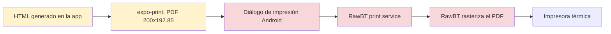
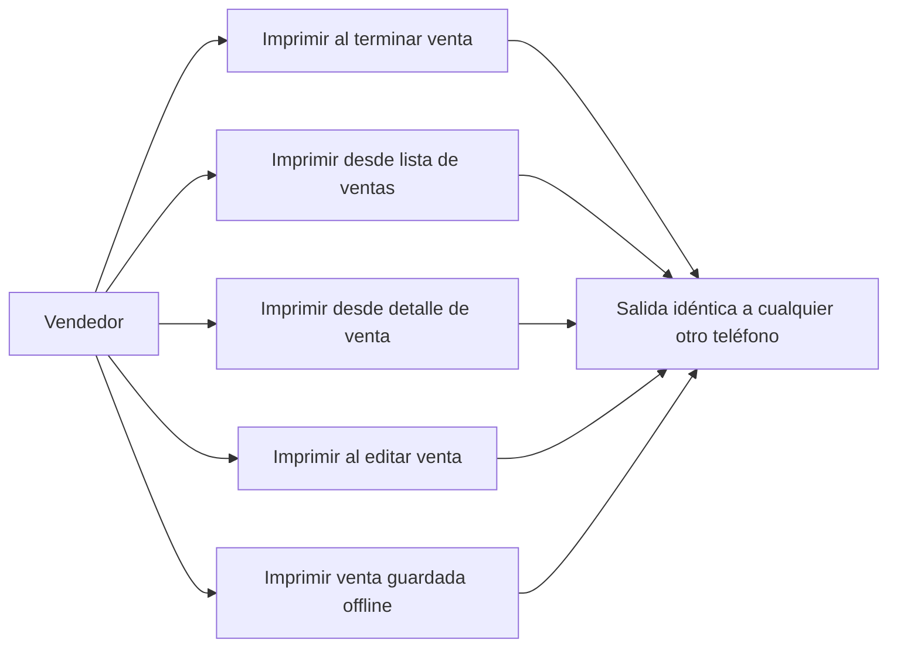
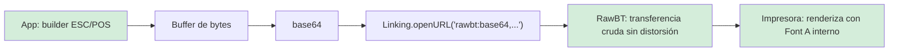

# RFC — Ticket térmico ESC/POS para ventas (57mm, vía RawBT)

## Estado del documento

- **Tipo**: RFC técnico + plan de implementación
- **Estado**: propuesta — **bloqueada por Fase 0** (validación de payload en impresora real)
- **Fecha**: 2026-09-22
- **Basado en**:
  - Auditoría de impresión de tickets (sesión 2026-09-22)
  - `src/screens/NewSale.js`, `src/screens/EditSale.js`, `src/screens/Sale.js`, `src/screens/DetailsSale.js`
  - `src/components/AlertPostSale.js`, `src/components/SaleItem.js`
  - Artefacto de prueba: `../pruebas-impresion/ticket-prueba-57mm.prn` (raíz del workspace)
- **Ámbito**: `golozurmobile` únicamente. Sin cambios en `gzapi`.
- **Rama de trabajo**: `feat/tickets-geolocation`
- **Fuera de alcance**: geolocalización (va en su propio RFC/ticket) y PDF A4 del backend (`GET /sale/print/:id`).

> El objetivo no es "mejorar el PDF": es dejar de depender del renderizado del teléfono. Hoy el ticket lo dibuja el sistema operativo; con este cambio lo dibuja la impresora.

---

## 1. Resumen ejecutivo

Hoy el ticket de venta se genera como HTML, se convierte a PDF con `expo-print` y se "imprime" pasando por el diálogo de impresión de Android, donde RawBT lo recibe como *print service* y lo rasteriza. En esa cadena el resultado depende de cada teléfono (densidad de pantalla, versión de WebView, escalado de fuente del sistema): **el mismo ticket sale con distinto tamaño de fuente y distinto espaciado según el dispositivo**.

Este RFC propone reemplazar el payload: **generar comandos ESC/POS crudos en la app y enviarlos a RawBT sin diálogo de impresión** (`rawbt:base64,<bytes>`). El texto lo renderiza la **fuente interna de la impresora** (Font A, 32 columnas para rollo de 57mm), no el teléfono. Resultado: **salida idéntica en todos los dispositivos**, sin agregar dependencias nativas y manteniendo RawBT como único canal hacia la impresora.

### Decisiones principales

1. **ESC/POS crudo**, enviado por URL scheme de RawBT (`Linking.openURL`), sin pasar por el Android Print Framework.
2. **Un solo módulo constructor** de ticket; se eliminan las 4 plantillas HTML duplicadas.
3. **Layout de 32 columnas** (Font A, 57mm) como única configuración; nada de tamaños en px CSS.
4. **Desaparece la paginación artificial** por chunks de 15 ítems: el rollo es continuo.
5. **Sin librerías nuevas**: `Buffer` + `Linking` (ya disponibles en el proyecto). No se usa `react-native-rawbt-api` (dependencia nativa no mantenida; innecesaria para texto).
6. **RawBT sigue siendo el canal**: no se reemplaza la app, no cambia el pairing Bluetooth, no cambia el flujo del usuario.
7. **Alcance Android**. En iOS se conserva el camino actual (PDF A4 del backend + compartir).

---

## 2. Problema

### 2.1 Síntoma reportado

La misma venta, impresa desde teléfonos distintos, sale distinta: tamaño de fuente diferente (según configuración de fuente del sistema), espaciado entre párrafos más compacto o más largo, y en general un layout que "no queda igual".

### 2.2 Cadena actual



Los pasos en rojo re-renderizan la salida con parámetros del dispositivo (densidad, WebView, escalado de texto). Los px CSS nunca son unidades físicas: no existe un valor "fijo" que garantice el mismo resultado entre teléfonos.

### 2.3 Evidencia técnica verificada

1. **Cuatro copias de la misma plantilla HTML** (duplicación y divergencia):
   - `src/screens/NewSale.js:295-467` (`generateHtmlContent` en `:355`)
   - `src/screens/EditSale.js:355-530` (`generateHtmlContent` en `:415`)
   - `src/screens/Sale.js:383-560` (`generateHtmlContent` en `:448`)
   - `src/screens/DetailsSale.js:190-369` (`generateHtmlContent` en `:255`)
2. **Precio unitario inconsistente entre copias**: `NewSale`/`EditSale` usan `precio || precioUnitario`; `Sale`/`DetailsSale` calculan `total / cantidad`.
3. **Firma ambigua `generatePdf(cliente)`**: los call sites pasan a veces `_id` (`DetailsSale.js:484`, `Sale.js:782`) y a veces nombre de cliente (`Sale.js:807`, `NewSale.js:599`, `EditSale.js:658`). En modo offline la búsqueda es `elem.cliente === cliente`, por lo que hay combinaciones que directamente no imprimen.
4. **Tamaño de página incorrecto para el rollo**: `width: 200` × `height: 192.85` (unidades de 1/72 pulgada) ≈ **70.6mm × 68mm por página**. El rollo es de 57mm → RawBT reescala; 57mm reales serían ~161.5 unidades.
5. **Paginación artificial**: `chunkArray(details.itemsSale, 15)` y `"Ticket X de Y"` por cada 15 ítems, con altura de página fija que no se adapta al contenido.
6. **Botón de impresión post-venta solo offline**: en `AlertPostSale.js:24-36` el botón online está comentado; el bloque visible requiere `offline`.
7. **`expo-print`** importado en las 4 pantallas (`NewSale.js:22`, `EditSale.js:23`, `Sale.js:15`, `DetailsSale.js:18`) exclusivamente para esto.

### 2.4 Consecuencias

- Imposible garantizar consistencia con el pipeline actual (no es un bug de un parámetro, es la arquitectura).
- Cuatro lugares donde arreglar cada cambio de formato.
- Deuda: lógica de impresión distinta según pantalla, con bugs de datos cruzados.

---

## 3. Objetivos

### 3.1 Funcionales

1. Que el ticket de una misma venta salga **idéntico** desde cualquier teléfono Android.
2. Mantener los 4 puntos de impresión actuales: post-venta, lista de ventas (online y offline), detalles de venta y edición.
3. Soportar acentos y caracteres del español (`á é í ó ú ñ Ñ ¿ °`).
4. Avance de papel y corte al final del ticket.
5. Mensaje claro si RawBT no está instalado.

### 3.2 Técnicos

1. Un único módulo constructor de ticket parametrizable por ancho de papel.
2. Eliminar las 4 plantillas HTML y la paginación por chunks.
3. Sin dependencias nativas nuevas; sin cambios de API.
4. Normalizar la obtención de datos del ticket (online/offline) y eliminar la ambigüedad `_id` vs `cliente`.

---

## 4. No objetivos

- Cambiar el PDF A4 del backend (`GET /sale/print/:id`, `POST /sale/print`) — sigue igual.
- Impresión de productos / listas de precios (`PrintProduct.js`) — otro flujo.
- Logo/imagen en el ticket (posible fase 2 vía bitmap `GS v 0`).
- Datos fiscales, numeración correlativa de comprobante, medios de pago — no existen en el modelo actual.
- Corregir que una venta **cancelada** imprime sin ítems (limitación conocida de `gzapi`: `getItemSale` filtra ítems con `estado:false`; ver `gzapi/src/services/itemSale.ts:16-27`). Se registra como incidencia aparte.
- Geolocalización — ticket separado.

---

## 5. Casos de uso afectados



| # | Caso | Fuente de datos | Hoy | Post-cambio |
| - | ---- | --------------- | --- | ----------- |
| 1 | Post-venta online | `GET /sale/:id` (por `_id` de la venta creada) | Botón oculto (comentado) | Botón visible, imprime ESC/POS |
| 2 | Post-venta offline | `saleStorage` | Imprime (solo offline) | Imprime ESC/POS |
| 3 | Lista online | `GET /sale/:id` por `_id` | Imprime PDF local + PDF A4 | Imprime ESC/POS |
| 4 | Lista offline | `saleStorage` por `cliente` | Imprime | Imprime ESC/POS |
| 5 | Detalle de venta | `details` en memoria / `GET /sale/:id` | Imprime (bug si offline con `_id`) | Imprime ESC/POS |
| 6 | Edición | `GET /sale/:id` tras actualizar | Imprime | Imprime ESC/POS |

---

## 6. Decisión de arquitectura

### 6.1 Enfoque elegido: ESC/POS crudo vía RawBT



RawBT documenta este modo como su propósito principal: transferir datos a la impresora **sin distorsión**. En modo crudo, el texto lo dibuja la impresora con su fuente interna:

- Font A = 12×24 puntos → rollo 57mm (384 puntos imprimibles) = **32 caracteres por línea**.
- El layout es una grilla de caracteres: mismas posiciones en cualquier teléfono, por construcción.
- No hay rasterizado, no hay escalado, no hay diálogo de impresión.

### 6.2 Alternativas evaluadas

| Alternativa | Veredicto |
| ----------- | --------- |
| Seguir con HTML/PDF y "normalizar" (`textZoom: 100`, `@page { size: 58mm auto }`, `mm` en CSS) | **Descartada como solución**: mejora algunos casos pero sigue pasando por el rasterizado del sistema; no garantiza igualdad entre dispositivos. |
| Librería nativa propia de Bluetooth (ESC/POS directo al dispositivo) | **Descartada**: reemplaza a RawBT, suma código nativo y mantenimiento, sin beneficio sobre el scheme. |
| `react-native-rawbt-api` (402d) | **Descartada**: dependencia nativa de 2022, innecesaria para tickets de texto; el scheme cubre el caso. |
| Imprimir solo desde el backend (PDF A4) | **Descartada**: no es impresión térmica. El A4 se mantiene para compartir, no para la térmica. |

---

## 7. Diseño propuesto

### 7.1 Configuración

Un solo lugar para el ancho de papel:

```js
// src/utils/thermal/constants.js (propuesto)
const PAPER_58MM = {
  id: '58mm',
  columns: 32,          // Font A, 384 dots / 12 dots por carácter
  charsPerLine: 32,
  cutCommand: 'partial' // 1D 56 42 00 — validar en Fase 0
}
```

- v1: solo `58mm`. Futuro `80mm` = 48 columnas (mismo builder, otra config).
- No hay configuración por pantalla: el layout vive en el builder.

### 7.2 Módulos propuestos (nuevos)

| Archivo | Responsabilidad |
| ------- | --------------- |
| `src/utils/thermal/constants.js` | Config de papel + mapas de encoding + comandos |
| `src/utils/thermal/escpos.js` | Capa de bytes: `init()`, `align()`, `size()`, `text()`, `twoColumns(left, right)`, `separator()`, `feed(n)`, `cut()` |
| `src/utils/thermal/ticket.js` | `buildSaleTicket(ticketData) → Uint8Array` — layout del ticket de venta |
| `src/utils/thermal/rawbt.js` | `sendToRawBT(bytes)` — base64 + `Linking.openURL('rawbt:base64,...')` + manejo de errores |

Reglas de implementación:

- `escpos.js` no conoce ventas; solo comandos y encoding.
- `ticket.js` no conoce pantallas; recibe datos normalizados.
- `rawbt.js` no conoce el contenido; solo transporte.
- Todo JS puro (sin JSX, sin estado), testeable de forma aislada.

### 7.3 Transporte (`rawbt.js`)

```js
// Pseudocódigo
const b64 = Buffer.from(bytes).toString('base64')
const url = `rawbt:base64,${b64}`
try {
  await Linking.openURL(url)
} catch {
  // RawBT no instalado / no disponible
  Alert.alert('RawBT no está instalado', 'Instalalo para imprimir en la térmica.')
  // Opcional: Linking.openURL('market://details?id=ru.a402d.rawbtprinter')
}
```

- Android only: en `Platform.OS !== 'android'`, no llamar a RawBT (ver 7.7).
- Nota de UX: al abrir `rawbt:` la app pasa a segundo plano mientras RawBT imprime; el usuario vuelve con "atrás". Es el comportamiento esperado del scheme.

### 7.4 Normalización de datos del ticket

Problema a resolver: hoy cada pantalla mezcla "obtener datos" con "generar HTML". Se separa en un único punto:

```js
// src/utils/thermal/ticket.js (o helper hermano)
async function getSaleTicketData({ mode, saleId, cliente, provided }) → SaleTicketData

type SaleTicketData = {
  cliente: string
  fecha: Date,
  items: { descripcion: string, cantidad: number, precioUnitario: number, total: number }[],
  total: number,
  estado?: string
}
```

Reglas:

1. `mode: 'online'` → `GET /sale/:id` con `saleId`. Se usa `r.data.r` + `r.data.itemsSale`.
2. `mode: 'offline'` → `saleStorage` buscando por `cliente` (comportamiento actual).
3. `mode: 'provided'` → objeto ya cargado en memoria (detalle de venta).
4. **Regla única de precio unitario**: `item.precio ?? item.precioUnitario ?? (item.total / item.cantidad)`. Se elimina la divergencia entre pantallas.
5. **Se elimina la ambigüedad de firma**: los call sites pasan explícitamente `{ mode, saleId }` o `{ mode: 'offline', cliente }`. Nunca más un parámetro llamado `cliente` que a veces es un `_id`.

Mapeo de call sites:

| Pantalla | Hoy | Nuevo |
| -------- | --- | ----- |
| `NewSale.js:599` | `generatePdf(cliente.value)` | `saleId` de la respuesta de creación (`POST /sale` devuelve la venta con `_id`) |
| `EditSale.js:658` | `generatePdf(cliente.value)` | `saleId` de la venta editada |
| `Sale.js:782` (online) | `generatePdf(item._id)` | `{ mode: 'online', saleId: item._id }` |
| `Sale.js:807` (offline) | `generatePdf(item.cliente)` | `{ mode: 'offline', cliente: item.cliente }` |
| `DetailsSale.js:484` | `generatePdf(details.r._id)` | `{ mode: 'online', saleId: details.r._id }`; si el detalle vino de offline, `{ mode: 'provided', provided: details }` |

### 7.5 Layout del ticket (v1)

Grilla de 32 columnas. Secuencia:

```
[init] 1B 40
[center + doble tamaño] GOLOZUR          ← 1D 21 11
[left]
Fecha: dd/mm/aaaa hh:mm                  ← incluir hora (hoy no se imprime)
Cliente: <nombre>
--------------------------------         ← 32 guiones
<descripción ítem>                        ← wrap a 32 con continuación indentada
  <cant>x <precio unitario>   <total>     ← twoColumns (izq 22 / der 10)
... (sin límite de ítems, sin chunks)
--------------------------------
TOTAL                        <total>
[center] *NO VALIDO COMO FACTURA
[feed 4] 1B 64 04
[cut] 1D 56 42 00
```

Reglas de layout:

- `twoColumns(left, right)`: `left.padEnd(22)` + `right.padStart(10)`; **assert de 32** en desarrollo.
- Descripciones largas: wrap a 32; continuaciones con 3 espacios de indentación. Nunca truncar en silencio.
- Números: `toLocaleString('es-AR', { minimumFractionDigits: 2, maximumFractionDigits: 2 })` en un helper compartido (hoy cada copia formatea distinto).
- Sin `"Ticket X de Y"`: el rollo es continuo.
- Encabezado del comercio: texto (no imagen) en v1.

### 7.6 Encoding

- Caracteres ASCII: byte directo.
- Acentos del español: mapa CP850/CP437 (ambas páginas coinciden para estos símbolos):

| Carácter | Byte | Carácter | Byte |
| -------- | ---- | -------- | ---- |
| á | `0xA0` | ñ | `0xA4` |
| é | `0x82` | Ñ | `0xA5` |
| í | `0xA1` | ¿ | `0xA8` |
| ó | `0xA2` | ° | `0xF8` |
| ú | `0xA3` | | |

- `encodeText()` debe fallar de forma controlada: todo carácter no mapeado se reemplaza por `?` (nunca dejar bytes inválidos).
- **Pendiente Fase 0**: confirmar en impresora real que la página de códigos por defecto es compatible. Si no, agregar `ESC t 2` (`1B 74 02`) al inicio del payload.

### 7.7 iOS

RawBT es Android-only. Decisión v1:

- Android → ESC/POS vía RawBT.
- iOS → se mantiene el camino actual de compartir PDF **A4 del servidor** (`downloadAndSharePDF`, ya existente en `Sale.js:346` y `DetailsSale.js:102`). No se mantiene el HTML de 57mm para iOS: si hay iPhones en uso, se evalúa en fase 2 con una única plantilla (no cuatro).
- El branch se decide con `Platform.OS` en un solo lugar.

### 7.8 Post-venta (`AlertPostSale`)

- Habilitar el botón "Imprimir" también en **online** (`AlertPostSale.js:24-36`): con el nuevo pipeline no hay motivo para restringirlo a offline.
- El botón queda condicionado al permiso existente (`hasPermissionUpdateSale`).
- El `AlertPostSale` no cambia su API: sigue recibiendo `print` como callback.

---

## 8. Contrato del payload (referencia Fase 0)

El artefacto `pruebas-impresion/ticket-prueba-57mm.prn` (325 bytes) es el **golden reference** del formato. Contenido:

| Comando | Bytes | Función |
| ------- | ----- | ------- |
| Initialize | `1B 40` | Reset impresora |
| Align center | `1B 61 01` | Centrado |
| Double size | `1D 21 11` | Doble ancho + alto |
| Normal size | `1D 21 00` | Tamaño normal |
| Align left | `1B 61 00` | Izquierda |
| Feed | `1B 64 04` | Avanza 4 líneas |
| Partial cut | `1D 56 42 00` | Avance a posición de corte + corte parcial |

Estructura verificada del reference: 3 ítems y TOTAL en filas de exactamente 32 caracteres, separadores de 32 guiones, línea de acentos `Acentos: á é í ó ú ñ Ñ ¿ °` codificada según la tabla de 7.6.

**Si Fase 0 falla en algún punto:**

- No corta → probar variantes: `1D 56 00` (corte completo), `1D 56 01`, o `1B 69` (algunos clones).
- Acentos incorrectos → agregar `1B 74 02` (ESC t 2, PC850) al inicio y volver a probar.
- Líneas de 32 no alinean → confirmar ancho real de papel/Font A en el manual de la impresora y ajustar `columns`.

---

## 9. Plan de implementación por fases

### Fase 0 — Validación de payload (bloqueante, manual)

- [ ] Imprimir `pruebas-impresion/ticket-prueba-57mm.prn` desde 2 teléfonos distintos (uno con fuente del sistema grande, otro chica), abriéndolo con RawBT.
- [ ] Verificar: alineación a 32 columnas, acentos correctos, corte al final, ambos tickets idénticos.
- [ ] Si hay desvíos, ajustar payload según 8 y regenerar el `.prn`.
- [ ] Documentar resultado en este RFC (sección 16).

### Fase 1 — Builder + transporte (sin tocar pantallas)

- [ ] Crear `src/utils/thermal/constants.js`, `escpos.js`, `ticket.js`, `rawbt.js`.
- [ ] Implementar `buildSaleTicket(ticketData)` con el layout de 7.5.
- [ ] Implementar `getSaleTicketData(...)` con los 3 modos de 7.4.
- [ ] Verificación: imprimir desde un trigger temporal (botón dev) un ticket generado por el builder y comparar contra el reference de Fase 0.

### Fase 2 — Integrar post-venta (NewSale + AlertPostSale)

- [ ] `NewSale`: usar el `_id` de la venta creada para el ticket.
- [ ] `AlertPostSale`: habilitar "Imprimir" en online (7.8).
- [ ] Probar: venta online → imprimir; venta offline → imprimir; desde 2 teléfonos → idéntico.

### Fase 3 — Migrar el resto de los puntos de impresión

- [ ] `Sale.js`: reemplazar `generatePdf` en ambos modos (online por `_id`, offline por `cliente`).
- [ ] `DetailsSale.js`: reemplazar `generatePdf`; resolver el modo `provided`.
- [ ] `EditSale.js`: reemplazar `generatePdf`.
- [ ] Probar cada caso de la tabla de sección 11.

### Fase 4 — Limpieza

- [ ] Eliminar de las 4 pantallas: `generateHtmlContent`, `chunkArray`, `itemsChunks`, imports de `expo-print`.
- [ ] Eliminar `Sharing` de los flujos de ticket (sigue usándose para el PDF A4: no tocar `downloadAndSharePDF`).
- [ ] Quitar triggers temporales de Fase 1.
- [ ] Revisar que no queden referencias a `width: 200` / `height: 192.85` en el repo.

### Fase 5 — Verificación manual y cierre

- [ ] Ejecutar la matriz de la sección 11 en dispositivo real.
- [ ] Actualizar este RFC con el resultado y marcar estado "implementado".
- [ ] Documentar para el equipo: RawBT debe tener configurado papel **58mm** en cada teléfono.

---

## 10. Criterios de aceptación

1. El mismo ticket impreso desde dos teléfonos con distinta configuración de fuente del sistema sale **idéntico** (misma grilla de 32 columnas, mismo espaciado).
2. No existe paginación artificial: un ticket con 40 ítems imprime en flujo continuo, sin `"Ticket X de Y"`.
3. Los acentos (`á é í ó ú ñ Ñ ¿ °`) salen correctos en la impresora.
4. El ticket corta al final.
5. Imprimir funciona en los 4 flujos: post-venta (online y offline), lista (online y offline), detalle y edición.
6. El botón "Imprimir" post-venta está disponible en online (no solo offline).
7. Si RawBT no está disponible, el usuario ve un mensaje claro y la app no crashea.
8. El layout del ticket vive en un solo módulo; no queda ninguna plantilla HTML de ticket en las pantallas.
9. El PDF A4 del backend (`downloadAndSharePDF`) sigue funcionando igual que antes.
10. En iOS no hay regresión: se mantiene el camino actual de compartir PDF.

---

## 11. Plan de verificación manual

| Caso | Precondición | Acción | Resultado esperado |
| ---- | ------------ | ------ | ------------------ |
| 1. Post-venta online | Permiso `update_sale` | Crear venta → Imprimir | Ticket ESC/POS correcto |
| 2. Post-venta offline | Sin conexión | Crear venta → Imprimir | Ticket ESC/POS correcto |
| 3. Lista online | Ventas del servidor | Tocar icono impresora | Ticket ESC/POS correcto |
| 4. Lista offline | Ventas locales | Tocar icono impresora | Ticket ESC/POS correcto |
| 5. Detalle | Abrir venta → Imprimir | — | Ticket ESC/POS correcto |
| 6. Edición | Editar venta → Imprimir | — | Ticket con datos actualizados |
| 7. Multi-teléfono | 2 teléfonos, fuente S y L | Imprimir la misma venta | Salidas idénticas |
| 8. Muchos ítems | Venta con 40+ ítems | Imprimir | Flujo continuo, sin chunks |
| 9. Acentos | Cliente/producto con acentos | Imprimir | Caracteres correctos |
| 10. Sin RawBT | Desinstalar RawBT | Imprimir | Mensaje claro, sin crash |
| 11. iOS | iPhone | Compartir PDF | Comportamiento actual intacto |

---

## 12. Riesgos y mitigaciones

| # | Riesgo | Mitigación |
| - | ------ | ---------- |
| 1 | Página de códigos distinta en la impresora | Fase 0 lo detecta; fallback `ESC t 2` (ver 8). |
| 2 | Variantes de comando de corte entre clones | Fase 0 define la variante correcta; config por impresora en `constants.js`. |
| 3 | RawBT mal configurado en algún teléfono (papel 58mm vs 80mm) | Documentar setup; el ticket asume 32 columnas, un papel mal configurado se ve al instante. |
| 4 | Teléfonos sin RawBT | Manejo de error de 7.3. |
| 5 | URL muy larga (payload base64 extenso) | Un ticket de texto es ~kBs, muy por debajo de los límites de intent URI. Si en el futuro se agrega logo bitmap, revisar. |
| 6 | Regresión en iOS | Se mantiene el camino A4 existente; caso 11 de la matriz. |
| 7 | Ventas canceladas imprimen sin ítems (limitación de API ya existente) | Fuera de alcance; registrar como incidencia separada en `gzapi`. |

---

## 13. Impacto en archivos

### Modificados

- `src/screens/NewSale.js` — reemplazo de `generatePdf`, habilitar impresión post-venta
- `src/screens/EditSale.js` — reemplazo de `generatePdf`
- `src/screens/Sale.js` — reemplazo en ambos modos (online/offline)
- `src/screens/DetailsSale.js` — reemplazo
- `src/components/AlertPostSale.js` — botón online

### Nuevos

- `src/utils/thermal/constants.js`
- `src/utils/thermal/escpos.js`
- `src/utils/thermal/ticket.js`
- `src/utils/thermal/rawbt.js`

### Externos al repo (workspace)

- `pruebas-impresion/ticket-prueba-57mm.prn` — reference de Fase 0
- `pruebas-impresion/ticket-prueba-57mm.base64.txt`

---

## 14. Decisiones abiertas

1. **¿Hay iPhones en uso?** Si no, simplificar 7.7 (solo Android). Si sí, confirmar que el A4 actual alcanza como fallback.
2. **Logo en el ticket** (bitmap `GS v 0`): fase 2 opcional.
3. **Ajustes de contenido**: ¿mostrar vendedor (`userCreate`), estado de la venta, descuento (`porcentaje`)? El builder queda listo para agregarlos, pero no se incluyen en v1 sin definición.
4. **Venta cancelada**: definir si debe imprimir con marca "CANCELADA" (requiere ajuste en API, hoy imprime vacía).

---

## 15. Siguiente paso recomendado

1. Ejecutar **Fase 0** (bloqueante) y registrar el resultado.
2. Con Fase 0 validada, implementar Fases 1 a 4 tal como están especificadas — el layout y los contratos de este RFC son suficientes para codificar sin decisiones adicionales.
3. Dejar la verificación de Fase 5 documentada en la sección 16.

---

## 16. Registro de validación Fase 0

_(Completar al ejecutar la prueba)_

- Fecha:
- Teléfonos probados:
- Alineación 32 columnas: OK / ajustar
- Acentos: OK / ajustar (¿`ESC t 2`?)
- Corte: OK / variante usada
- Observaciones:
